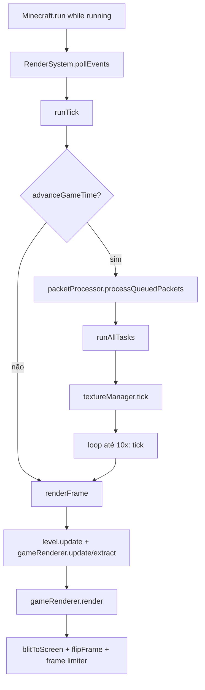
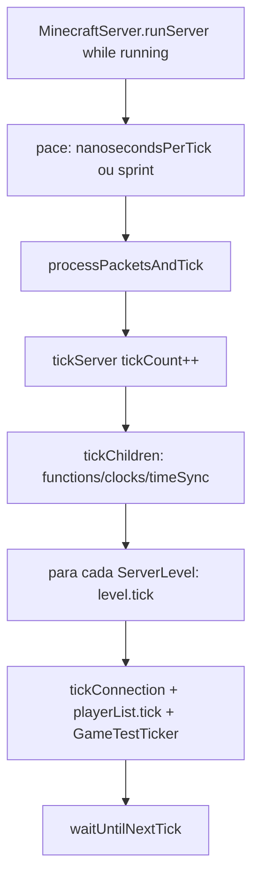

# Arquitetura — Ciclo principal do jogo (26.1.2)

**Versão:** 26.1.2 · **Confiança:** alta [FATO] · **Descoberta:** `research/discoveries/E2-game-loop.md`

## Visão geral
Dois `while (running)` independentes unidos por pacotes: cliente (Render thread, `Minecraft.run`) e servidor (Server thread, `MinecraftServer.runServer`). Singleplayer roda ambos no mesmo processo, threads separadas.

## Loop do cliente (diagrama)

## Loop do servidor (diagrama)

## Pontos estruturais
1. **Pace**: cliente acumula tempo (`DeltaTracker.Timer`, residual de ~50 ms/tick, máx. 10 catch-up); servidor visa 20 TPS exatos dormindo até o próximo deadline e loga "Can't keep up!" ao atrasar.
2. **Pausa**: `TickRateManager` (`runsNormally`, `frozenTicksToRun`, `/tick freeze|step|rate`) controla simulação em mundo; cliente pausa jogo quando window/pause screen indica (singleplayer), mantendo render ativo.
3. **Rede**: drenagem de pacotes no tick, nunca during render; `suspendFlushing`/`resumeFlushing` em torno do tickChildren.
4. **Agregação**: servidor mantém `tickTimesNanos[100]` → MSPT médio (log 20 TPS/10 s e crash/overload handling); cliente mantém `metricsRecorder` por tick/frame.
5. **Tick cliente**: processa GUI → gameMode → screens → keybinds → mundo (`level.tickEntities/tickBlockEntities/level.tick`) → áudio → `ServerboundClientTickEndPacket`.
6. **Tick servidor**: auto-pause se vazio → tickCount++ → functions/clocks → **níveis** (weather, scheduled ticks block/fluid, raid, chunkSource, blockEvents, entities, blockEntities, iceandsnow, randomTick) → players/network chunkSender.

## Renderização interpola, tick simula
Render acontece **sempre** (mesmo pausado); simulação só quando `ticksToDo > 0` (cliente) / `haveTime` (servidor). Partial tick (`getGameTimeDeltaPartialTick`) interpola posição visual entre ticks. Frozen → partial = 1.0.

## Relações com outros sistemas
- **Inicialização** (`initialization.md`): pré-requisito — registries congelados antes do loop.
- **Rede**: fila `packetProcessor` drenada no tick; `/tick` commands via `CommandSource` no servidor.
- **Renderização**: `gameRenderer.update → extract → render` trifásico; `MainTarget` offscreen → `blitToScreen`.
- **Áudio**: `SoundManager.tick` por tick; `soundManager.updateSource` por frame.
- **Persistência**: autosave `ticksUntilAutosave` no servidor; emergencySave no cliente (OOM / crash).

## Limites conhecidos
- Seções internas de `ServerLevel.tick` não dissecadas (próxima missão: E4-chunk/scheduled-ticks).
- `level.update()` e trifásico `extract/render` pendentes (missão de renderização).
- Singleplayer loopback path (IntegratedServer ↔ cliente) não mapeado em detalhe.
