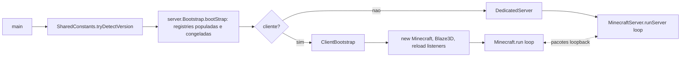

# Visão geral da arquitetura do Minecraft (26.1.2)

> Mantido por agentes de IA. Última atualização: 2026-11-05 (E1+E2).

## Entrypoints [FATO]
- Cliente: `net.minecraft.client.main.Main#main` (thread "Render thread")
- Servidor dedicado: `net.minecraft.server.Main#main` (thread "Server thread")

## Fluxo em alto nível

## Loop principal — ver `game-loop.md`
Cliente: acumula tempo com `DeltaTracker.Timer` (20 TPS alvo, máx. 10 catch-up), renderiza sempre, tiqueia simulação até 10×/frame. Servidor: `nanosecondsPerTick` fixo, dorme até deadline, "Can't keep up!" + salta atraso.

## Sistemas mapeados
- Inicialização: `architecture/initialization.md` ✅ (E1)
- Ciclo principal: `architecture/game-loop.md` ✅ (E2)
- Registries/registro de bloco: `registries/block-registration.md` ✅ (E3)
- Mundo/chunks (loading/status/tickets/storage/networking): `world/chunk-*.md` ✅ (E4)
- Iluminação: `world/lighting-engine.md`, `lighting-threading.md`, `chunk-save-unload-integrity.md` ✅ (E4b)
- Worldgen: `world/world-generation.md`, `noise-system.md`, `biome-generation.md`, `chunk-generation-stages.md`, `structures-and-features.md` ✅ (E5)

## Sistemas pendentes (prioridade sugerida)
Worldgen detalhado (biomas, ruído, estruturas) → Entidades/IA → Networking (protocolo geral) → Persistência/NBT → Renderização → Áudio → Blocos/Itens → Física

Ver `knowledge/INDEX.md` para a lista completa.
