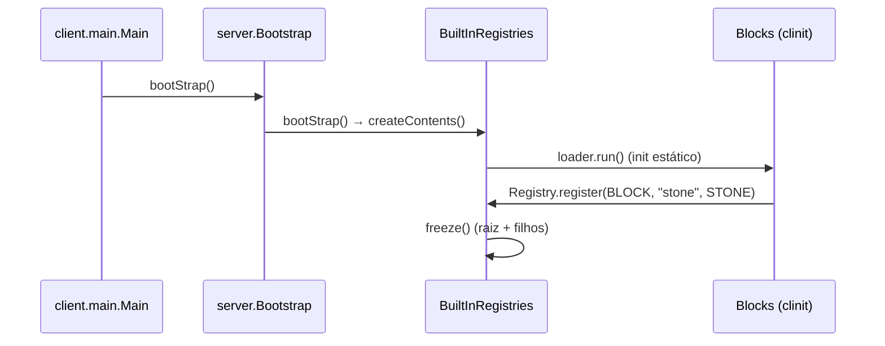

# Registro de um bloco (26.1.2)

**Confiança:** alta [FATO] · **Classes:** `net.minecraft.core.registries.BuiltInRegistries`, `net.minecraft.world.level.block.Blocks`, `net.minecraft.core.Registry`

## Cadeia de registro [FATO]

1. `BuiltInRegistries` (classe-holder) cria `public static final DefaultedRegistry<Block> BLOCK = registerDefaultedWithIntrusiveHolders(Registries.BLOCK, "air", registry -> Blocks.AIR)` (linha ~180).
   - `registerDefaultedWithIntrusiveHolders` → `DefaultedMappedRegistry<>("air", name, Lifecycle.stable(), /* intrusiveHolders */ true)`.
   - Registra loader lazy: `LOADERS.put(Registries.BLOCK.identifier(), () -> loader.run(registry))`.
   - Também registra no registry-de-registries: `WRITABLE_REGISTRY.register(ResourceKey<WritableRegistry<?>>)` com `RegistrationInfo.BUILT_IN`.
   - Guarda: `Bootstrap.checkBootstrapCalled(...)` — qualquer registro antes do bootstrap lança exceção.
2. `Bootstrap.bootStrap()` → `BuiltInRegistries.bootStrap()` → `createContents()` → executa cada loader uma vez.
3. Rodar o loader `registry -> Blocks.AIR` inicializa **estaticamente** a classe `Blocks`:
   - Campos `public static final Block STONE = register("stone", Properties...)` → `register(ResourceKey, ...)` → `properties.setId(id)` → `factory.apply(...)` → `Registry.register(BuiltInRegistries.BLOCK, id, block)`.
   - `ResourceKey.create(Registries.BLOCK, Identifier.withDefaultNamespace(name))` ("minecraft:stone").
4. Ao final de `<clinit>` de `Blocks`: loop estático preenche `Block.BLOCK_STATE_REGISTRY` e chama `state.initCache()` para todos os states possíveis.
5. `freeze()`: registry raiz + todos os filhos são congelados; tags bound a vazio. Depois disso, qualquer `register` lança exceção.

## Default value
- Registry de blocos é `DefaultedMappedRegistry` com default `"air"` — consultas por chave desconhecida retornam AIR, não erro.

## Tags e data packs
- Após freeze, tags associadas a registries são vinculadas a vazio; a carga REAL de tags acontece pela infraestrutura de data pack do servidor (`TagLoader` / `ReloadableServerResources`) — NÃO verificada ainda.

## Diagrama Mermaid

## Pendências
- Verificação de tags via data pack (E5 de outra missão).
- `Block.BLOCK_STATE_REGISTRY` — natureza exata pós-26.x (era `StateHolder`/`StateDefinition` id?): confirmar no código de `Block.java`.
- Lifecycle.stable vs experimental (feature flags) — mapear onde a flag é aplicada.

## Referências
- `sources/26.1.2/net/minecraft/core/registries/BuiltInRegistries.java` (linhas ~175-215, ~380-420)
- `sources/26.1.2/net/minecraft/world/level/block/Blocks.java` (campos e `register`, fim do arquivo)
