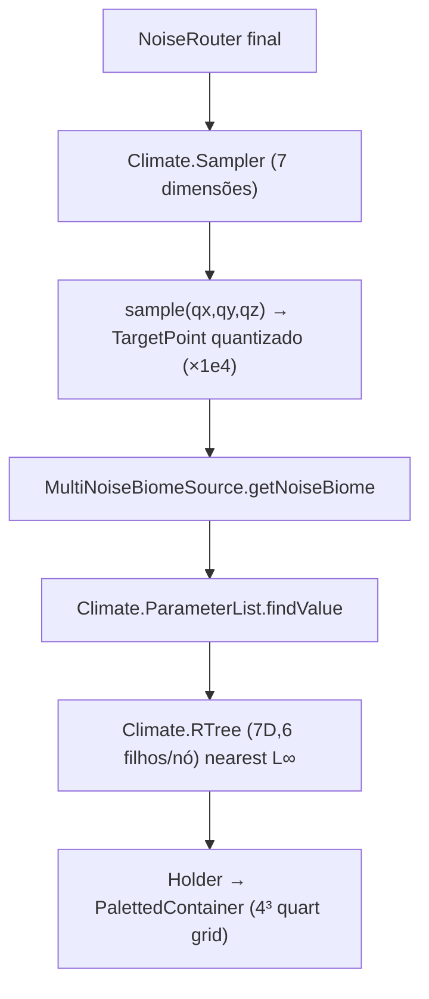

# Mundo — Geração de biomas (26.1.2)

**Confiança:** [FATO] · Evidência: `research/discoveries/E5-world-generation.md` §4, §8

## Visão geral

## As 7 dimensões climáticas (quarts)
`temperature`, `vegetation` (humidity), `continents`, `erosion`, `depth`, `weirdness` (peaks_and_valleys no debug), + `offset` (usado só na ordenação R-tree/fitness).
`Climate.quantizeCoord(coord) = long(coord × 10000)`; spec ranges tipo ±2.
`PARAMETER_COUNT = 7` (verificado em `Climate.java`).

## Estrutura do registry
`MultiNoiseBiomeSource` (CODEC mapEither direct/preset `minecraft:overworld` etc.) ou `Holder<MultiNoiseBiomeSourceParameterList>`.
Overworld na prática: datapack `data/minecraft/worldgen/multi_noise_biome_source_parameter_list/overworld.json` — usa preset builder (`OverworldBiomeBuilder`) se presente — **não verificado na 26.1.2 (ver W5)**.

## Consulta e normalização
1. `fillBiomesFromNoise`: itera seções; por seção grava container 4×4×4 (quarts).
2. Cada quart chama `biomeResolver.getNoiseBiome(qx, qy, qz, sampler)`.
3. `sampler.sample`: `temperature/vegetation/continents/erosion/depth/ridges` (do NoiseRouter "flattener" deduplicado) + `spawnTarget`; quantiza.
4. `findValue`: R-tree nearest — `fitness(parameters) = Σ L∞ distancia(k)` por dimensão (parametros como intervalos [min,max] — `Parameter.fitness(target)`).
5. Resultado: `Holder<Biome>` com o `biomeResolver` (abaixo-zero retrogen envolve este resolver se necessário — `BelowZeroRetrogen.getBiomeResolver`).

## Relações
- **Surface**: `SurfaceRules` avalia biome para escolher blocos de superfície (`buildSurface`).
- **Estruturas**: predicado de biome (`structure.biomes()`) no STRUCTURE_STARTS; também por `StructurePlacement` (bioma-agnostic pos check + `isStructureChunk`).
- **Features/carvers**: `BiomeGenerationSettings` por biome (carvers ±8, features por step).
- **Climate/soil** no render: `Climate.Sampler` também alimenta F3 debug screen e `density_hq`.

## Limites
- `Climate.RTree.search` — maior distância = melhor; `lastResult` ThreadLocal (cache de 1 resultado por thread — acelera chamadas sequenciais do fill).
- Distrito do Nether/End: Nether usa `NetherBiomeSource`?? — em 1.18+ o Nether continua `MultiNoiseBiomeSource` com router nether (confirmar em E5b — W5). O código de `nether` biome source não foi achado em 26.1.2 sob esse nome; assume-se multi-noise unificado.
- Biomes granularity = quart; não existem "biome borders" de 1 bloco (apenas multi-noise interpolado por quart) — diferente de 1.17-.
