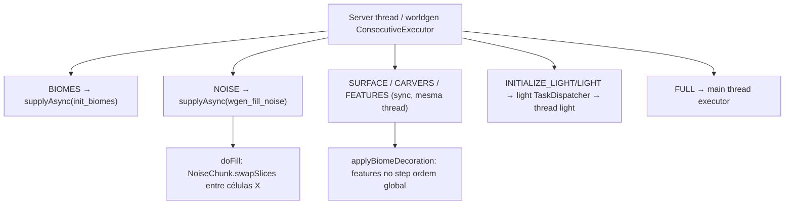

# Mundo — Estágios de geração de chunks (26.1.2)

**Confiança:** [FATO] · Evidência: `research/discoveries/E5-world-generation.md` §2 + `research/discoveries/E4-chunk-loading.md` §5

Este documento é a ponte E4↔E5: detalha o que acontece **dentro** de cada estágio.

## Sequência (GENERATION_PYRAMID)


## Tabela de chamadas (26.1.2)
| Estágio | Classe/Método | Dependência | Executor |
|---|---|---|---|
| EMPTY | `ChunkMap.scheduleChunkLoad` → `SerializableChunkData.read` | disco/vazio | mainThread/parseChunk |
| STRUCTURE_STARTS | `ChunkGenerator.createStructures` (cria `StructureSet` check + `structure.generate`) | — | worldgen |
| STRUCTURE_REFERENCES | `ChunkGenerator.createReferences` | STRUCTURE_STARTS **r=8** | worldgen |
| BIOMES | `NoiseBasedChunkGenerator.createBiomes` → `doCreateBiomes` → `fillBiomesFromNoise` | STRUCTURE_STARTS **r=8** | **`init_biomes` pool** |
| NOISE | `fillFromNoise` → `doFill` → `NoiseChunk.doFill` (trilhinear) | STRUCTURE_STARTS **r=8**, BIOMES **r=1** | **`wgen_fill_noise` pool** |
| SURFACE | `buildSurface` → `SurfaceSystem.buildSurface` (rules) | mesma | worldgen |
| CARVERS | `applyCarvers` — carvers de ±8 chunks com `setLargeFeatureSeed(seed+idx, x, z)` | STRUCTURE_STARTS **r=8** | worldgen |
| FEATURES | `applyBiomeDecoration` — N steps `GenerationStep.Decoration`; structures no step | STRUCTURE_STARTS **r=8**, CARVERS **r=1** | worldgen |
| INITIALIZE_LIGHT | `ThreadedLevelLightEngine.initializeLight` | — | light thread (async) |
| LIGHT | `lightChunk` (fixpoint block+sky) | INITIALIZE_LIGHT **r=1** | light thread (async) |
| SPAWN | `spawnOriginalMobs` (sporadic entities) | BIOMES **r=1** | worldgen |
| FULL | `ChunkStatusTasks.full` (ProtoChunk→LevelChunk, entities postLoad, registerBlockEntities) | — | **main thread executor** |

`blockStateWriteRadius`: NOISE=0, SURFACE=0, CARVERS=0, **FEATURES=1** (única etapa com cross-chunk write).
LOADING_PYRAMID variante: apenas `loadStructureStarts` + `initializeLight` + `light` + `full` — todo terreno já em disco.

## Acesso a chunks vizinhos durante worldgen [FATO — conferido em E5b]
`WorldGenRegion.getChunk(x, z)` só devolve chunks com distância Chebyshev `< generatingStep.directDependencies().size()` — fora lança `ReportedException("Requested chunk unavailable during world generation")` com categoria completa. `hasChunk(...)` idêntico. `WorldGenTickAccess` garante que block/fluid ticks ficam dentro do chunk gerador. Código de worldgen NUNCA lê fora do pirâmide.

## Transições de objetos
```
ProtoChunk (status=EMPTY/NP...) → preenche NOISE/`BELOW_ZERO_RETROGEN` → CARVERS(CarvingMask) 
→ FEATURES → INITIALIZE_LIGHT (setLightEngine) → LIGHT (isLightCorrect) → SPAWN 
→ FULL:  ImposterProtoChunk(LevelChunk) OU new LevelChunk(...); holder.replaceProtoChunk(); futures voltam a apontar para ImposterProtoChunk
```

## Neighborhoods e estruturas
- r=8 para STRUCTURE_*: maxStructureSize ~ 8 (MAX_STRUCTURE_DISTANCE = 8 em ChunkStatus).
- carvers ±8 chunks: varre quadrado de 17×17 chunks buscando carvers com start no chunk (`isStartChunk`) — daí o custo O(289) por chunk de carver check.
- `WorldGenRegion` expões `getChunk` garantindo disponibilidade de chunks vizinhos pelo ticket level/dependência prévia — garantido pelo pirâmide r≥1.
- `Blender` (blend de biomas/noise antigo 1.18→blend old chunks): pré-configurado para região (`Blender.of(region)`) somente se o chunk precisa blending (`isUpgrading`/blending_data), senão `Blender.empty()`.

## Execução assíncrona (quem roda onde)


## Futuros
Cada estágio = 1 futuro por holder no `futures[12]` do `GenerationChunkHolder`; `ChunkStatus.getStatusList()` define a ordem; `applyStep` executa task só se `persistedStatus < targetStatus`; `completeChunkGeneration` marca persistido após sucesso; `full` (main thread) completa FULL futuro → `prepareTickingChunk/accessibleChunk` (E4).

## Armadilhas
- LIGHT exige INITIALIZE_LIGHT de vizinhos r=1 — luz só converge com 3×3 prontos.
- SPAWN pode spawnar mobs apenas em chunks com origem válida para spawn (debug/worldgen — `spawnOriginalMobs` chamado só em geração, não em load).
- `createBiomes` é assíncrono (pool init_biomes) — não consume thread worldgen; `doCreateBiomes` usa `cachedClimateSampler`.
- FULL nunca roda concorrente — serializado no main thread executor.
