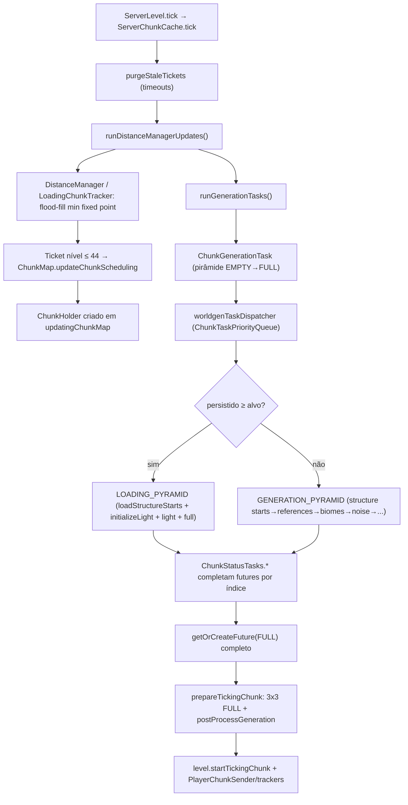

# Mundo — Carregamento de chunks (26.1.2)

**Versão:** 26.1.2 · **Confiança:** [FATO] (evidência: `research/discoveries/E4-chunk-loading.md`)
Documentos irmãos: `chunk-status.md` (estágios), `chunk-tickets.md` (tickets), `chunk-storage.md` (disco/NBT), `chunk-networking.md` (envio ao cliente).

## Papel do sistema
Carregar do disco (ou gerar) chunks sob demanda, manter os que precisam estar ativos (tickets), descarregar os demais, e sincronizar com clientes.

## Fluxo de um pedido de chunk (servidor)

## Quem faz o quê (mapa rápido)
- **`ServerLevel`** — chama `chunkSource.tick(haveTime, tickChunks)` (registrador de nível no tick global).
- **`ServerChunkCache`** — API pública do mundo (`getChunk`, tickets, `tick`, spawn de mobs, `save`, unload).
- **`ChunkMap`** — orquestrador: storage (`.mca`), `updatingChunkMap`/`pendingUnloads`/`visibleChunkMap`, save, unload, envio, tracking de players, POI.
- **`ChunkHolder`/`GenerationChunkHolder`** — 12 futures (um por `ChunkStatus`) + 3 futures de nível cheio (FULL / BLOCK_TICKING / ENTITY_TICKING) com CAS.
- **`ChunkGenerationTask`** — percorre a pirâmide por camadas (quadrado de raio acumulado), decide carga vs. geração **por camada** (`canLoadWithoutGeneration`).
- **`ChunkTaskDispatcher`** — fila por ticket level (`ChunkTaskPriorityQueue`, 46 níveis, pop = menor nível = mais prioritário), executa na `ConsecutiveExecutor` "worldgen" / "light".
- **`applyStep`** — EMPTY → `scheduleChunkLoad(pos)` (disco); demais → `step.apply(...)` na thread adequada.
- **`ChunkStatusTasks`** — a lógica real de cada estágio (estruturas, biomas, ruído, superfície, carvões/inglíquido, features, luz, spawn, "full").

## Regras de ouro verificadas no código
1. Registries devem estar congelados antes (ver `initialization.md`); `TicketStorage.TYPE` etc. são SavedData persistentes.
2. **LOADING vs GENERATION são decididos por camada** dentro de uma mesma task — um chunk salvo em disco com `Status=FULL` ainda re-executa `initializeLight/light/full` (frameworks leves), mas nunca `noise/surface`.
3. Chunk com `persistedStatus ≥ alvo` não regera (idempotente via `ChunkStep.apply`).
4. Ticket `UNKNOWN` (timeout 1 tick) é o ticket provisório para QUALQUER `getChunk(..., loadOrGenerate=true)` — expira sozinho via `purgeStaleTickets`.
5. Oticado: `promoteChunkMap()` — snapshot (`visibleChunkMap = updatingChunkMap.clone()`) após mudanças.

## E4 status
- Pipeline ponta-a-ponta: confirmado no código.
- Gargalos estáticos identificados: ver `chunk-tickets.md` §6 e discovery §6/§9.
- Pendências H1–H8: ver `research/discoveries/E4-chunk-loading.md` §10.
