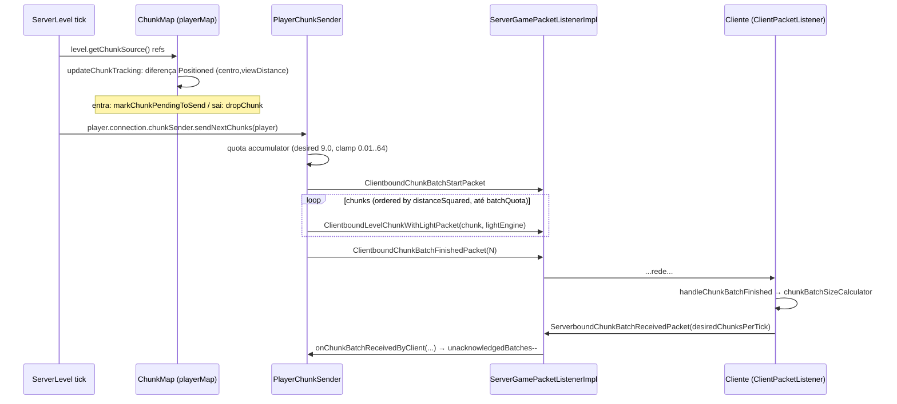

# Mundo — Sincronização servidor→cliente de chunks (26.1.2)

**Confiança:** [FATO] · Evidência: `research/discoveries/E4-chunk-loading.md` §8

## Visão geral

## Servidor — quem decide o quê
- **O que enviar:** `ChunkMap.applyChunkTrackingView` (via `updateChunkTracking`) → `ChunkTrackingView.difference` → `pendingChunks` do `PlayerChunkSender`.
- **Centro/raio:** `ClientboundSetChunkCacheCenterPacket(center.x, center.z)` no mesmo passo (cliente pinta view).
- **Raio efetivo:** `player.requestedViewDistance()` clampado a `serverViewDistance` (2..32, servidor manda; `setServerViewDistance` atualiza `updatePlayerTickets` + todos os players).
- **Ordem:** menor `distanceSquared(player, chunk)` primeiro; se pendentes > batchQuota, seleciona os N mais próximos.
- **Ritmo (client-driven adaptativo):** `desiredChunksPerTick` (começa **9.0**; clamp **0.01..64.0**; NAN→0.01). `batchQuota` acumula `desired` por envio; só envia quando `batchQuota ≥ 1`; **no máx. 10 batches unacknowledged** após primeiro ACK (inicia com 1).
- **Só envia `sendSync` pronto:** `getChunkToSend()` retorna null enquanto `sendSync` (sync de send) não completar.
- **Conteúdo do pacote:** `ClientboundLevelChunkWithLightPacket(levelChunk, lightEngine, skyFilter=null, blockFilter=null)`:
  - `ClientboundLevelChunkPacketData`: `heightmaps` (Usage.CLIENT → WORLD_SURFACE, MOTION_BLOCKING, MOTION_BLOCKING_NO_LEAVES), `buffer` (seções serializadas, máx **2 MB**, `TWO_MEGABYTES`), `blockEntitiesData` (NBT por bloco com block entity).
  - `ClientboundLightUpdatePacketData`: BitSet sky/block changed sections + dados de luz (TrustEdges/seções) — no pacote inicial **sem filtro** (todas as seções).
- **Biomes em separado:** `ChunkMap.resendBiomesForChunks` → `ClientboundChunksBiomesPacket` (raro, sob demanda — consumidor exato: H2).
- **Desligar chunk no cliente:** `ClientboundForgetLevelChunkPacket` quando sai da tracking view (ou chunk cai).
- **Atualizações pós-load:** `chunkHolder.hasChangesToBroadcast()` por tick → `PlayerChunkSender`? Não — via `ChunkHolder.broadcastChanges(chunk)` (block updates single ou `ClientboundSectionBlocksUpdatePacket` batch; light update `ClientboundLightUpdatePacket` filtrado) → `ServerChunkCache.broadcastChangedChunks` no fim do tick do spawner.
- **Envio de map/telemetry:** `clientboundChunkBatchStart/Finished` apenas delimitadores (não carregam dados).

## Cliente — como processa
1. `handleLevelChunkWithLight` (`ClientPacketListener`): `PacketUtils.ensureRunningOnSameThread` → `updateLevelChunk` → `ClientLevelChunkSource.replaceWithPacketData(x,z,buffer,heightmaps,blockEntitiesConsumer)` (novo `LevelChunk` cliente a partir dos bytes).
2. `queueLightUpdate(...)`: `applyLightData` → insere luz por seção (`setSectionRangeDirty`) → `levelRenderer.onChunkReadyToRender(chunk.getPos())`.
3. `handleForgetLevelChunk`: `level.getChunkSource().drop(pos)` + `queueLightRemoval` + `debugSubscriber.dropChunk`.
4. `handleChunkBatchStart/Finished`: `ChunkBatchSizeCalculator` mede o tempo/bytes; `getDesiredChunksPerTick()` nasce do histórico (`chunkBatchSizeCalculator.getDesiredChunksPerTick()`); envia `ServerboundChunkBatchReceivedPacket`.
5. `handleSetChunkCacheCenter` (separado) — atualiza centro do cliente (view da câmera).

## Diferenças 1.21.x → 26.1.x (relevante)
- Protocolo de batch + `ServerboundChunkBatchReceivedPacket` já existe desde 1.20.2 [DOC] e permanece idêntico em 26.1.
- `ClientboundChunksBiomesPacket` (split de biomes no pacote) continua presente em 26.1.2.

## Armadilhas documentadas no código
- `PlayerChunkSender.sendNextChunks` **não faz nada** se `unacknowledgedBatches >= maxUnacknowledgedBatches` — servidor espera ACK do cliente.
- `getChunkToSend` null enquanto `sendSync` não completo (ex.: chunk FULL recém-promovido aguardando confirmação de luz).
- 2 MB cap: chunk gigante (muito longas seções) → `RuntimeException` no decode client (“Chunk Packet trying to allocate too much memory”).
- O cliente **aplica** update via `ensureRunningOnSameThread` — pacote está frio na thread IO até o tick do cliente rodar (paralelo ao design server→tick→flush).
