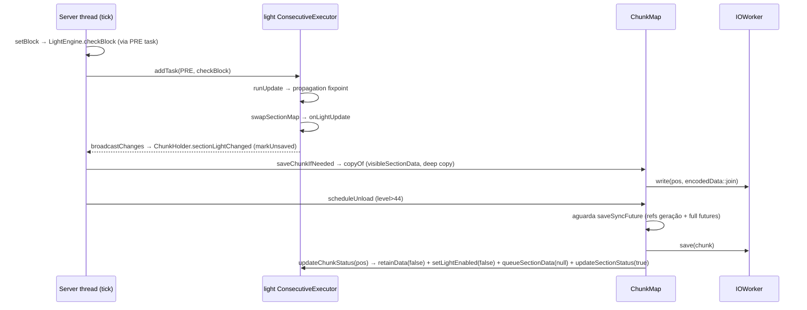

# Mundo — Integridade de save/unload vs. lighting (26.1.2)

**Confiança:** [FATO] salvo RISCO marcado · Evidência: `research/discoveries/E4b-light-engine.md` §5–6 + `research/discoveries/E4-chunk-loading.md`

## Fluxo integrado (lighting × save × unload)


## Pergunta central
“O que acontece com dados de luz quando o chunk é salvo/descarregado/recarregado, sob concorrência?”

## Garantias efetivamente encontradas no código
1. **Cópia profunda no snapshot:** `SerializableChunkData.copyOf` (main thread, dentro de `save()`) copia `chunkSections[i].copy()` e lê luz via `lightEngine.getLayerListener(layer).getDataLayerData(SectionPos)` — retorna `visibleSectionData` — copia cada `DataLayer` com `.copy()`. Nenhuma referência mutável do engine sobrevive ao encode.
2. **Encode assíncrono sobre dados imutáveis:** `CompletableFuture.supplyAsync(data::write, Util.backgroundExecutor())` — NBT gerado em background a partir de estruturas já copiadas; `this.write(pos, encodedData::join)` na IOWorker.
3. **Ordenamento de unload:** `ChunkMap.scheduleUnload`:
   ```
   saveSyncFuture → thenRunAsync(() -> {
       if (currentFuture != saveSyncFuture) { scheduleUnload(...); return; }   // re-check de nova geração
       if (pendingUnloads.remove(pos, holder) && chunk != null) {
           ((LevelChunk) chunk).setLoaded(false);
           save(chunk);
           level.unload(levelChunk);
           lightEngine.updateChunkStatus(chunk.getPos());
           lightEngine.tryScheduleUpdate();
       }
   }, unloadQueue::add)
   ```
   ⇒ unload só acontece após `saveSyncFuture` completar; nele:
   - `generationSaveSyncFuture` — geração referenciada cair a zero (`increase/decreaseGenerationRefCount`);
   - `fullChunkFuture`/`accessibleChunkFuture`/`tickingChunkFuture`/`entityTickingChunkFuture` (via `addSaveDependency` em `updateFutures`).
4. **Snapshot visível:** `swapSectionMap` troca `visibleSectionData = updatingSectionData.copy()` — WRITER do save nunca vê `updatingSectionData` parcialmente escrito (swap é atômico sob a thread `light`).
5. **isLightCorrect como contrato de reload:** chunk salvo com `isLightCorrect=false` ⇒ no próximo load, `LIGHT`/`INITIALIZE_LIGHT` reexecutam (`isLighted()` false) — luz incompleta no disco é sempre recalculada.
6. **Seções sem dados não persistem:** `queuedSections` não swap-adas e seções nunca `hasData` não geram `DataLayer` — nada inconsistente a salvar.
7. **Save nunca sobrescreve FULL com protótipo velho:** `save()` aborta se disco já tem FULL (`isExistingChunkFull` via `chunkTypeCache`/re-read) quando `persistedStatus` não é LEVELCHUNK.
8. **`unsavedListener`**: toda mudança de bloco/luz marca `chunksToEagerlySave` → eager save (≤20/tick, ≤128 writes ativos, 10 s/chunk).

## Consistência de luz vs. concorrência (cenário por cenário)
| Cenário | O que o código garante |
|---|---|
| Save concorrente com propagação de luz (outra thread) | `copyOf` roda na main thread; dados de luz lidos de `visibleSectionData` (estável pós-swap). Propagação em voo fica em `updatingSectionData` e não entra no snapshot — o campo `isLightCorrect` diz se o chunk está pronto; se estiver `false`, reload refaz INITIALIZE_LIGHT/LIGHT. |
| Unload de chunk com tarefas de luz pendentes | `scheduleUnload` espera `saveSyncFuture` e drena `save()` antes de `level.unload`; `updateChunkStatus` (PRE) limpa dados de luz após unload; POST tasks já agendadas rodam na thread `light` (futuros POST restantes tocam o holder — holder já removido do mapa, tasks toleram — tarefas de light já enfileiradas via `taskDispatcher` ainda rodam mas operam em engine cujo estado do chunk foi retido/removido: `storingLightForSection==false` ⇒ `checkNode` no-opa). [FATO] |
| Reload após crash | NBT `Status/isLightCorrect` reconstituídos — `Status=FULL` + `isLightCorrect=true` ⇒ chunk reutilizado (LOADING_PYRAMID: só loadLight+full). `isLightCorrect=false`/ausente ⇒ recalcula luz. |
| Cancel/delay de tarefas | `markedForCancellation` na `ChunkGenerationTask` → `removeTask` → futures `UNLOADED_CHUNK`; `updateHighestAllowedStatus` cancela futures acima do nível novo (`failAndClearPendingFuturesBetween`) — tarefas de luz já despachadas continuam (idempotentes). [FATO] |
| Luz em chunk vizinho altera chunk salvo/unloaded? | Seção vizinha escrita → `sectionsAffectedByLightUpdates` → swap → `onLightUpdate` → `chunkHolder.sectionLightChanged` → marca `markUnsaved` e dirty parcels — mas **se o chunk não está TICKING** (`getTickingChunk()==null`) não marca unsaved ⇒ pode permanecer stale em disco até reload? — Na prática: `sectionLightChanged` faz `markUnsaved` sobre o chunk INITIALIZE_LIGHT-headed mesmo sem ticking (ver código: `chunk.markUnsaved()` na parte INÍCIO antes do ticking check). [FATO] |

## Riscos identificados (NÃO são bugs comprovados)
- **R1 (stale luz no disco):** save eager pode serializar `visibleSectionData` antiga — comportamento deliberado (consistência > frescor). Reload resolve.
- **R2 (PRE task exception):** exceção em PRE_UPDATE (light thread) → task morre, POST nunca roda, future `lightChunk`/`initializeLight` nunca completa → chunk trava estágio, sem crash explícito no log (só futuro jamais completo). [RISCO teórico — não reproduzido]
- **R3 (unload durante geração):** holder em `pendingUnloads` ganha level > 44 ⇒ `updateHighestAllowedStatus` falha futures — mas a task roda em thread worldgen por até 1 batch; player move para longe e volta antes do unload → `pendingUnloads.remove(node)` tentado no `updateChunkScheduling` (chunk reutilizado de `pendingUnloads`). OK. [FATO]
- **R4 (`addSendDependency` default done):** `sendSync` default `completedFuture(null)` — só `waitForLightBeforeSending` (EnderDragon) adiciona dependência de luz real ao send; para players NORMAIS o **envio do chunk não espera a luz do 3×3** — a luz chega depois via `ClientboundLightUpdatePacket`/seções. [FATO — não é bug, é design]
- **R5 (crash entre encode e IOWorker.write):** `encodedData::join` dentro de `write(pos, supplier)` executa no FOREGROUND → se crash entre futures filhos → chunk perdido? Não — o dado original em memória permanece unsaved (`tryMarkSaved` só após `save()` retornar true). Crash → próximo boot: chunk no disco é o antigo (consistente). [FATO]

## Conclusão
Não foi encontrada **regressão comprovada**. O design é consistente por: (i) snapshot copy-on-write no main thread; (ii) `visibleSectionData` imutável pós-swap; (iii) `saveSyncFuture` cobrindo refs de geração e futures de nível; (iv) `isLightCorrect` como contrato de recálculo; (v) ordem save→unload→light detach. Riscos R1–R5 são teóricos/comportamentais, nenhum com caminho de corrupção de save comprovado em análise estática.
