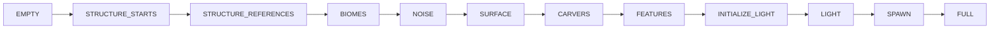

# Mundo — ChunkStatus: estágios de geração (26.1.2)

**Confiança:** [FATO] · Evidência completa: `research/discoveries/E4-chunk-loading.md` §5

## Sequência (índices confirmados em `ChunkStatus.java`)

- Registrado em `BuiltInRegistries.CHUNK_STATUS` (codec = `byNameCodec`).
- `ChunkType.PROTOCHUNK` até SPAWN; `FULL` produz `LevelChunk`.
- Heightmaps: `WORLDGEN_HEIGHTMAPS` (OCEAN_FLOOR_WG, WORLD_SURFACE_WG) até CARVERS; `FINAL_HEIGHTMAPS` (OCEAN_FLOOR, WORLD_SURFACE, MOTION_BLOCKING[_NO_LEAVES]) de CARVERS em diante.

## Dependências e tarefas (GENERATION_PYRAMID)

| Step | Task | Dependências (raio Chebyshev) | Write radius |
|---|---|---|---|
| EMPTY | passThrough | — | — |
| STRUCTURE_STARTS | structure starts via `ChunkGenerator.createStructures` (respeita `generateStructures()`) | EMPTY | — |
| STRUCTURE_REFERENCES | `createReferences` | STRUCTURE_STARTS **r=8** | — |
| BIOMES | `createBiomes` (async) | STRUCTURE_STARTS **r=8** | — |
| NOISE | `fillFromNoise` + BelowZeroRetrogen | STRUCTURE_STARTS **r=8**, BIOMES **r=1** | 0 |
| SURFACE | `buildSurface` | STRUCTURE_STARTS **r=8**, BIOMES **r=1** | 0 |
| CARVERS | `applyCarvers` + Blender mask | STRUCTURE_STARTS **r=8** | 0 |
| FEATURES | `applyBiomeDecoration` (+ `primeHeightmaps`) | STRUCTURE_STARTS **r=8**, CARVERS **r=1** | **1** |
| INITIALIZE_LIGHT | `initializeLightSources` + `lightEngine.initializeLight` (gate `isLightCorrect`) | — | — |
| LIGHT | `lightEngine.lightChunk` (gate `isLightCorrect`) | INITIALIZE_LIGHT **r=1** | — |
| SPAWN | `spawnOriginalMobs` (se não-upgrading) | BIOMES **r=1** | — |
| FULL | `ProtoChunk`→`LevelChunk` (main thread; entities postLoad; `registerAllBlockEntitiesAfterLevelLoad`; `registerTickContainerInLevel`; `setLoaded`) | — | — |

Acumuladas do step FULL (distância → status): `[SPAWN, INITIALIZE_LIGHT, CARVERS, BIOMES, STRUCTURE_STARTS ×8]` → `RADIUS_AROUND_FULL_CHUNK = 11`.

## LOADING_PYRAMID (chunk existente em disco)
`loadStructureStarts` (chama `level.onStructureStartsAvailable`) → `passThrough` (STRUCTURE_REFERENCES…SPAWN) → `initializeLight` → `light` (**exige INITIALIZE_LIGHT r=1**) → `full`. Zero geração de terreno.
Antes de cada camada, `ChunkGenerationTask.canLoadWithoutGeneration()` valida que o disco cobre o requisito — senão a camada vira geração via GENERATION_PYRAMID.

## Como o futuro se completa
`ChunkStep.apply` → `ChunkStatusTasks.<task>` (lambdas estáticos) → `task.doWork` → `Future` por índice (`futures[12]` em `GenerationChunkHolder`, CAS `compareAndExchange`). `ChunkStep.completeChunkGeneration` marca `persistedStatus` após sucesso. `MAX_STRUCTURE_DISTANCE = 8` — por isso r=8 nas estruturas.

## Observações
- FEATURES é o único write radius=1: decoração (árvores/minérios) pode escrever em chunk vizinho dentro de 1.
- STRUCTURE_* aqui chama `createStructures`/`createReferences` do gerador configurado (NoiseBasedChunkGenerator), com `StructureManager`/`forWorldGenRegion`.
- `BelowZeroRetrogen` (below_zero_retrogen) é aplicado pós-noise (bedrock masks old-chunks).
- O estágio FULL substituiu definitivamente qualquer uso de "LEVELCHUNK type" intermediário: `ChunkType.LEVELCHUNK` só aparece no resultado final.
