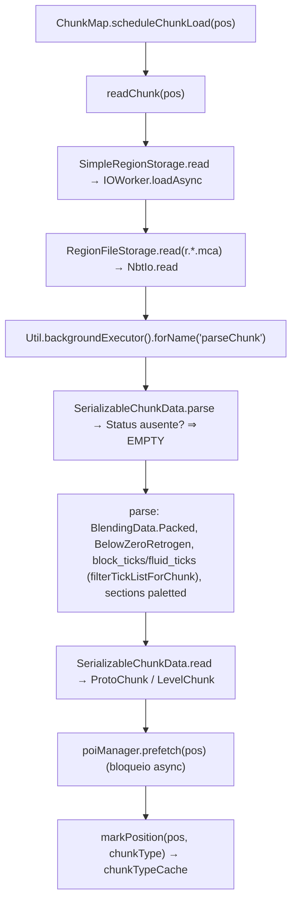
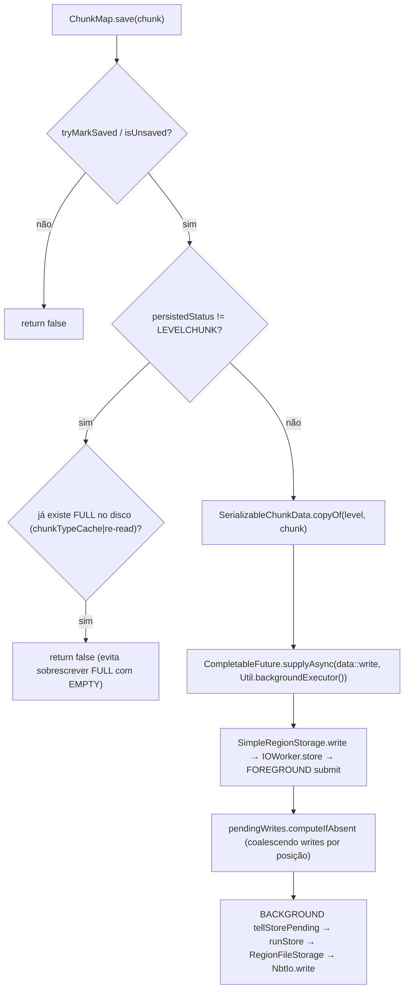

# Mundo — Armazenamento de chunks (26.1.2)

**Confiança:** [FATO] · Evidência: `research/discoveries/E4-chunk-loading.md` §7

## Layout em disco
```
<world>/region/           # Overworld
<world>/DIM-1/region/     # Nether
<world>/DIM1/region/      # End
   r.<rx>.<rz>.mca        # 1 região = 32×32 chunks (Anvil)
<dim>/poi/r.<x>.<z>.mca   # POI da região (mesma engine)
```
- `RegionFileStorage` → `r.rx.rz.mca` (`ANVIL_EXTENSION=".mca"`); cache LRU `MAX_CACHE_SIZE=256` regiões; header 8 KB (2 setores × 4096 B); setores 4 KB; external file `.mcc` para chunks > 256 setores (`EXTERNAL_STREAM_FLAG=128`); `RegionFile`/`RegionBitmap` gerenciam bitmap de setores.

## Fluxo de leitura


## Fluxo de escrita/salvamento

NBT escrito: `xPos/zPos, Status, Heightmaps, sections[] (paletted, inclui block/sky light se isLightOn), block_ticks, fluid_ticks, blending_data?, below_zero_retrogen?, UpgradeData, isLightOn, Heightmaps, block entities/...` (ver `SerializableChunkData.write()` — 26.1.2).

## Pacing e concorrência
- `saveChunkIfNeeded`: **throttle por chunk de 10 s** (`nextChunkSaveTime.put(pos, now + 10000L)`).
- `saveAllChunks(flushStorage=true)` (shutdown/autosave): loop até `didWork` falso, `mainThreadExecutor.managedBlock(chunk::isReadyForSaving)`, `ImposterProtoChunk|LevelChunk` apenas; depois `poiManager.flushAll()` → `processUnloads(() -> true)` → `synchronize(true)`.
- **save eager** (unsavedListener): `chunksToEagerlySave` → até **20/tick**, ≤ **128 writes ativos** (`activeChunkWrites`), `now < nextChunkSaveTime` respeitado.
- **Descarga de memória**: `toDrop` (nível > 44) → `updatingChunkMap → pendingUnloads` → `scheduleUnload` → aguarda `saveSyncFuture` → `setLoaded(false)` → `save(chunk)` → `level.unload(levelChunk)` → `lightEngine.updateChunkStatus`.
- **IOWorker**: `PriorityConsecutiveExecutor(FOREGROUND, BACKGROUND, SHUTDOWN)` sobre `ioPool()` (cached); leitura durante write pendente retorna cópia (`PendingStore.copyData`); `synchronize` = barreira; `close` = barreira SHUTDOWN.
- `isOldChunk`: `DataVersion < 4295 || blending_data` → tratado como pré-1.18 (Blender/below_zero_retrogen path).

## Notas críticas
1. Chunk protótipo **nunca** sobrescreve um FULL já salvo (proteção explícita).
2. `chunk_tickets.dat` guarda só tickets persistentes (`forced`, `portal`) — forçar `/forceload` sobrevive a restart; `unknown`/`player_*` não.
3. `poi` usa storage separado — corromper o POI não perde o terreno, mas quebra pathfinding/spawning.
4. `saveChunksEagerly` lida com mudanças em chunks carregados que o jogador tocou.

## Limites desta investigação
- `.mca` interno (formato de header/streams) verificado só estruturalmente (setores 4 KB, `SECTOR_INTS=1024`, `CHUNK_HEADER_SIZE=5`); parsing byte-a-byte não dissecado.
- `SerializableChunkData.write` completo não linha-a-linha.
- Salvamento de `SavedDataStorage` (POI, tickets, data maps) mapeado; formato `.dat` NBT padrão (não dissecado aqui — ver E-persistence).
