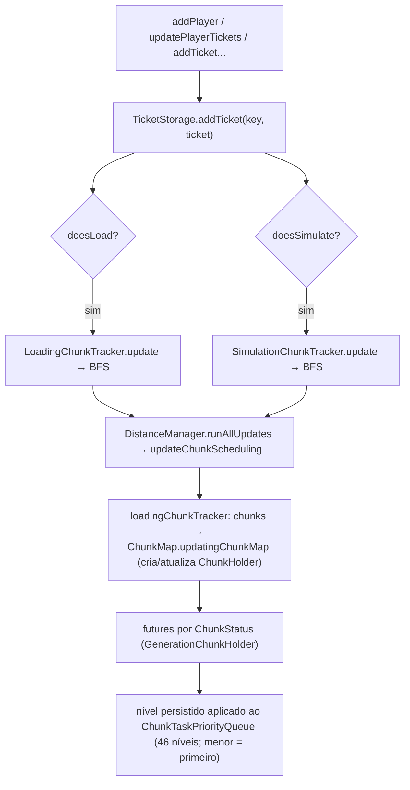

# Mundo — Sistema de tickets (26.1.2)

**Confiança:** [FATO] · Evidência: `research/discoveries/E4-chunk-loading.md` §3–6

## O que é um ticket
Uma "reivindicação" sobre um chunk: `{type, ticketLevel, ticksLeft}`. Chunks com nível ≤ 44 ficam carregados; o nível mais baixo entre os tickets válidos define o nível efetivo. Ticket deixa o mundo girar:
- **`doesLoad`** → faz o chunk existir (gera/carrega do disco).
- **`doesSimulate`** → faz o chunk TICAR (mobs, blocos, aleatório).
- **`persist()`** → sobrevive ao reboot do servidor (salvo em `chunk_tickets.dat`).

## De onde vêm os tickets (criados no código)
1. **Jogador em cena:** `DistanceManager.addPlayer/removePlayer` (SectionPos) → `Ticket(PLAYER_SIMULATION, max(0, 31 − simulationDistance))` (default simDist=10 → **nível 21**).
2. **View distance (loading):** `ChunkMap.setServerViewDistance` → `DistanceManager.updatePlayerTickets` → `PlayerTicketTracker(32)` → `Ticket(PLAYER_LOADING, 31)` em todo chunk dentro da distância de visualização (processado via `ThrottlingChunkTaskDispatcher(4)`); `updateViewDistance` gera diffs add/remove.
3. **Forçados (`/forceload`):** `TicketStorage.updateChunkForced` → `Ticket(FORCED, 31)` (persist). `getForceLoadedChunks()`.
4. **Pedidos síncronos de chunk:** `ServerChunkCache.getChunkFutureMainThread` → `Ticket(UNKNOWN, byStatus(target))` com timeout 1 tick.
5. **Finais/misc:** portais/ender-pearls/spawn-search/dragon via `addTicketWithRadius` (nível = 33 − raio) ou tipos específicos (`portal` 15 ticks de timeout 300, persist).

## Catálogo (verificado em `TicketType.java`)

| Type | Timeout (ticks) | Flags | persist | load | simulate | dimensão | expira-se-unloaded |
|---|---|---|---|---|---|---|---|
| `player_spawn` | 20 | 2 | | ✓ | | | |
| `spawn_search` | 1 | 2 | | ✓ | | | |
| `dragon` | 0 | 6 | | ✓ | ✓ | | |
| `player_loading` | 0 | 2 | | ✓ | | | |
| `player_simulation` | 0 | 12 | | ✓ | ✓ | ✓ | |
| `forced` | 0 | 15 | ✓ | ✓ | ✓ | ✓ | |
| `portal` | 300 | 15 | ✓ | ✓ | ✓ | ✓ | |
| `ender_pearl` | 40 | 14 | | ✓ | ✓ | ✓ | ✓ |
| `unknown` | 1 | 18 | ✓ | ✓ | | | ✓ |

Registro: `BuiltInRegistries.TICKET_TYPE` (cada type é um `TicketType` record com bitmask `FLAGS`).

## Níveis efetivos (verificado + computado do código)
`ChunkLevel`: `isLoaded ≤ 44`, `ENTITY_TICKING ≤ 31`, `BLOCK_TICKING ≤ 32`, `FULL ≤ 33`, `INACCESSIBLE > 33`.
`byStatus` (33 + raio acumulado no step FULL): `STRUCTURE_STARTS→44 · INITIALIZE_LIGHT/FEATURES→34 · BIOMES/STRUCTURE_REFERENCES→36 · NOISE/SURFACE/CARVERS→35 · LIGHT/SPAWN/FULL→33`.
`generationStatus(level) = getStatusAroundFullChunk(level − 33)`.
`FULL_CHUNK_STEP.accumulatedDependencies` (distância→status): `[SPAWN, INITIALIZE_LIGHT, CARVERS, BIOMES, S_STARTS×8]` → `RADIUS_AROUND_FULL_CHUNK = 11`, `MAX_LEVEL = 44`.

## Propagação (como o mundo "espalha")
`ChunkTracker → DynamicGraphMinFixedPoint`: `nível(nó) = min( fonte(nó), ∀vizinho₈: nível(vizinho) + 1 )`. Fontes: `LoadingChunkTracker.getLevelFromSource` (tickets doesLoad) / `SimulationChunkTracker` (doesSimulate; default 33). Por isso um ticket em 0 rapidamente "pinta" 44 chunks em anéis até dissipar — cada anel +1.

## Ciclo de vida / remoção
- `purgeStaleTickets(chunkMap)` a cada `ServerChunkCache.tick`: decrementa `ticksLeft` dos tickets com timeout; remove em `< 0` respeitando `canExpireIfUnloaded` (portal/ender-pearl/etc. — pode expirar em chunk já pronto) e `isReadyForSaving` (nunca mata ticket se o chunk está no meio de save).
- `PLAYER_LOADING` sai quando o jogador cruza a borda da view distance (`PlayerTicketTracker`); `PLAYER_SIMULATION` sai em `removePlayer`; FORCED sai com `/forceload remove` → `updateChunkForced(false)`.
- Ticket nível > 44 ou "dropped" → `toDrop` → `processUnloads` → salva e descarrega (`scheduleUnload` aguarda `saveSyncFuture`; `pendingUnloads.remove`).

## Interação com ticks do mundo
- `isEntityTicking(queueLevel ≤ 31)` ⇒ mobs/AI; `isBlockTicking(≤ 32)` ⇒ block/fluid ticks; nível 33 ⇒ existe mas **não** tica; níveis 34–44 ⇒ sendo gerado/a montar.
- `SimulationChunkTracker.chunks` é um `Long2ByteMap` com default 33 — só armazena ≤ 32.

## Persistência e dimensão ativa
`shouldKeepDimensionActive()`: qualquer ticket com flag 8 (`player_simulation`, `forced`, `portal`) mantém a dimensão carregada (relevante para servidores idle).

## Gargalos potenciais (estático)
- `PlayerTicketTracker.updateViewDistance` itera **todos** os chunks perto players — O(view²).
- Dispatch de tickets via `ThrottlingChunkTaskDispatcher(4)`: bulk-loading de spawn (muitos tickets PLAYER_LOADING simultâneos) passa por 4 permits.
- `chunksToUpdateFutures` por tick pode conter milhares de holders em transições massivas de view distance.
