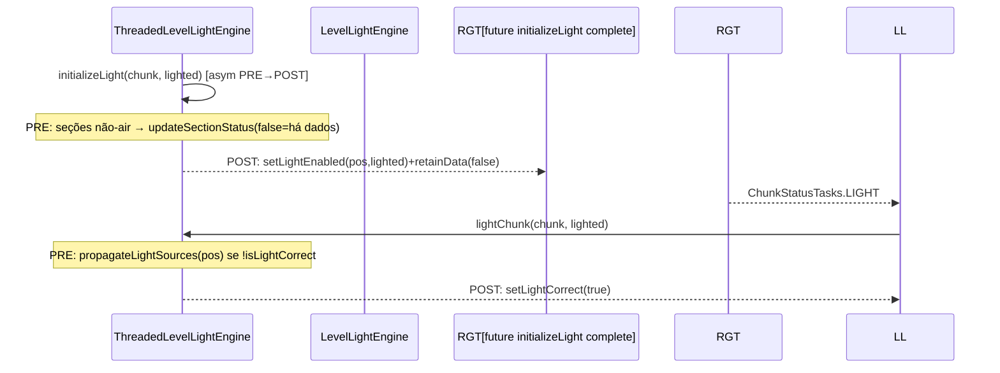
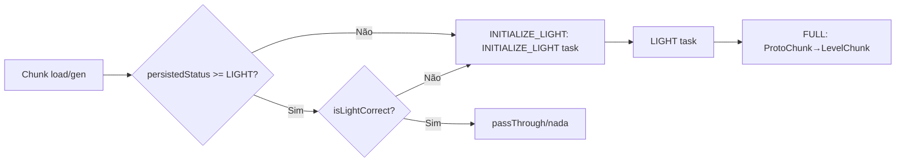

# Mundo — Lighting engine (26.1.2)

**Confiança:** [FATO] · Evidência completa: `research/discoveries/E4b-light-engine.md`
Documentos irmãos: `lighting-threading.md`, `chunk-save-unload-integrity.md`

## Arquitetura (resumo)
```mermaid
flowchart TD
  A[checkBlock / updateSectionStatus / propagateLightSources ...] --> B[ThreadedLevelLightEngine.addTask]
  B --> C[lightTaskDispatcher / ChunkTaskPriorityQueue por ticket level]
  C --> D[threading "light": lightTasks batch]
  D --> E[runUpdate: PRE tasks → runLightUpdates → POST tasks]
  E --> F[BlockLightEngine & SkyLightEngine]
  F --> G[LayerLightSectionStorage: updatingSectionData → swap → visibleSectionData]
  G --> H["onLightUpdate → ServerChunkCache → sectionLightChanged → broadcast"]
```

## Block light vs Sky light
| Aspecto | Block light | Sky light |
|---|---|---|
| Classe | `BlockLightEngine` | `SkyLightEngine` |
| Fonte | `BlockState.getLightEmission()` (se seção "light on") | Sol: coluna via `ChunkSkyLightSources` (`getLowestSourceY`) |
| Partida | `checkNode`: emission → increase/decrease | `checkNode`: compara `y >= lowestSourceY`; `updateSourcesInColumn` |
| Oclusão | `getLightBlockInto`/`shapeOccludes` (VoxelShape face) | mesma, via herança do `LightEngine` |
| Inicialização | `propagateLightSources`: `findBlockLightSources` | `propagateLightSources`: SkyLightEngine.propagateLightSources |
| Seções sem dados | `storingLightForSection` evita alocar | `getLightValue`: fallback sobe seções até achar (retorna 15 acima do topo) |
| Armazenamento | `BlockLightSectionStorage` | `SkyLightSectionStorage` (+ `topSections` por coluna) |

`LightEngine.MAX_LEVEL=15`; opacidade mínima 1 (`MIN_OPACITY`).
Flags em `QueueEntry`: bits 0–3 nível, 4–10 direções (6), bit 10 `FROM_EMPTY_SHAPE`, bit 11 `INCREASE_FROM_EMISSION`.

## Pipeline INITIALIZE_LIGHT → LIGHT (chunk)


## Diagrama — relação chunk loading ↔ ChunkStatus ↔ lighting


## Fila de veiculação de luz (batchs)
- batch = 1000 tarefas (`lightTasks`); `tryScheduleUpdate` chamado a cada poll do main thread executor; `runLightUpdates()` sem limite de iterações — fixpoint interno.
- Seção vazia após swap → `onLightUpdate` marca broadcast; chunk `markUnsaved`.

## Armadilhas
- Sunlight acima do mundo: `SkyLightSectionStorage` retorna 15 para seções acima de `topSection` (sem DataLayer).
- Seção y < topSection mas sem dados abaixo de 15: nas células nunca escritas a luz é 15 (não há leitura de DataLayer antigas inválidas).
- Seção virou ar ⇒ seção removida e propagação via neighborCount; neighborCount ≤ 26 (bitfield 5).
