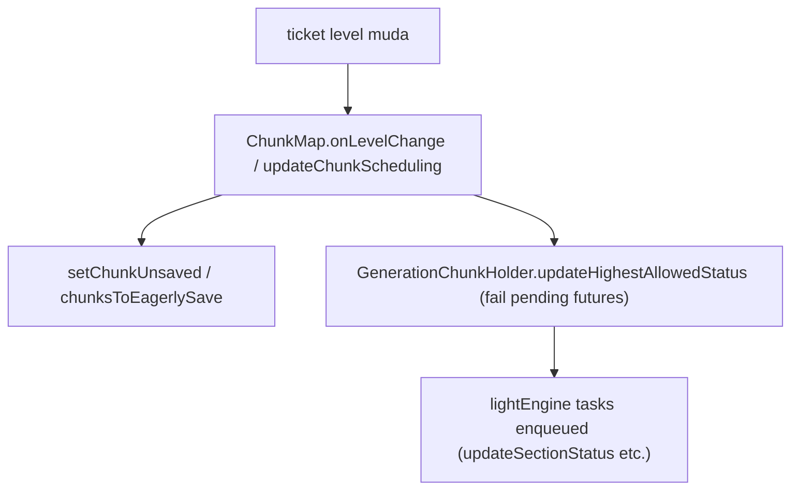

# Mundo — Threading do Light Engine (26.1.2)

**Confiança:** [FATO] · Evidência: `research/discoveries/E4b-light-engine.md` §3

## Visão geral de threads
| Thread | Papel |
|---|---|
| "Server thread" (main) | `ServerLevel.tick` → `chunkSource.tick` → `ServerChunkCache.pollTask()` → `tryScheduleUpdate()` (marca necessidade de light update) |
| "Chunk source main thread executor" (`MainThreadExecutor` por dimensão) | executa `MainThreadExecutor` tasks incl. as chamadas via `supplyAsync(..., mainThreadProcessor)` e **FULL** task (ChunkStatusTasks.full) |
| "worldgen" (ConsecutiveExecutor sobre `backgroundExecutor`) | `ChunkGenerationTask` (pirâmide), tarefas de geração, INCLUSIVE `applyStep(EMPTY→load)` |
| "light" (ConsecutiveExecutor sobre `backgroundExecutor`) | `ThreadedLevelLightEngine.runUpdate()` — PRE/POST + `runLightUpdates()` (block+sky fixpoint) |
| "IO-Worker-N" (cached pool) | `IOWorker` — IO de chunk (read/write .mca) |
| "Main" (pool background, cores−1=7 threads) | encode NBT (`data::write`), parse (`parseChunk`), background general |

`ThreadedLevelLightEngine` **não tem thread própria** — o “trabalho de luz” executa na thread `light` do `ConsecutiveExecutor`, a partir de `consecutiveExecutor.schedule(...)`.

## Contrato das tarefas de luz
1. `addTask(x, z, [level], PRE_UPDATE|POST_UPDATE, runnable)`:
   - `level` default = `chunkMap.getChunkQueueLevel(pos)` (ticket level da posição no momento).
   - dispatch → `lightTaskDispatcher.submit(runnable, key, level)` → `PriorityConsecutiveExecutor(4, executor, "dispatcher")` → `ChunkTaskPriorityQueue.submit` (fila por ticket level, LRU) → quando processada: o runnable só **acumula** `lightTasks` (ObjectArrayList) — thread `dispatcher` libera rápido.
2. Após ≥ 1000 tarefas acumuladas **durante** esse dispatch, `runUpdate()` roda inline na mesma thread — processa as 1000 leves mais antigas.
3. `pollTask()` do main thread executor invoca `tryScheduleUpdate()` a cada poll: se tem trabalho e ainda não está `scheduled`, agenda `runUpdate` na thread `light`.
4. `runUpdate()` (thread light): `PRE_UPDATE` (até 1000, na ordem) → `super.runLightUpdates()` → `POST_UPDATE` → `iterator.remove()`.
5. `DEFAULT_BATCH_SIZE = 1000` e `taskPerBatch = 1000` (hardcoded; `taskPerBatch` não usado — mesmo padrão “constante morta” do H1).
6. Futuro de task (`CompletableFuture.supplyAsync(..., r -> this.addTask(..., POST_UPDATE, r))`) — a completion do POST agenda via `supplyAsync` no custom executor (`r -> addTask(POST, r)`) — futuro Java padrão; nada especial.
7. `waitForPendingTasks(x, z)`: enfileira POST vazio → quando futur completion visível, tudo que estava antes na fila daquela posição já rodou (barreira por posição / por lightTaskDispatcher).
8. `runLightUpdates()` chamado de outra thread ⇒ `UnsupportedOperationException` imediata.

## Ordem e visibilidade
- `updatingSectionData` ↔ `visibleSectionData` — swap no final de `runLightUpdates`; leitores (render/save/envio biomes) leem **visible**; escritores (PRE/POST/light) operam em **updating** com copy-on-write + `changedSections`.
- `queuedSections` (sincronizado) guarda **seções enfileiradas** que aguardam `markNewInconsistencies` (consumidas no swap).
- `sectionStates` byte: bit5 = hasData, bits0–4 = neighborCount (≤26) — evita alocar `DataLayer` para chunks sem dados.

## Encadeamento com chunks/tickets

## Gargalos potenciais (estático)
1. **Uma posição = uma task por update** → tempestade de setBlock em 1000 blocos de um chunk gera 1000 tarefas (até 1000 por chamada `runUpdate` — ainda assim serial na thread light).
2. `tryScheduleUpdate` só dispara de `pollTask()` (main thread executor) — se o servidor está ocioso (sem poll), luz pendente espera o próximo poll — ok em prática (poll a cada tick).
3. Propagação gulosa sem limite de fixpoint → pior caso explícito é O(n·15) por batch, `decreaseQueue/increaseQueue` drenados inteiros.
4. `chunksToEagerlySave` + luz: mudança de luz marca unsaved — save eager pode serializar `visívelSectionData` velha (consistente, mas possivelmente stale) — ver `chunk-save-unload-integrity.md`.

## Limites
- `getChunkQueueLevel` no momento do `addTask`: o ticket level da posição naquele instante define a fila de prioridade; se o nível mudar antes da execução, a tarefa é repriorizada pelo mecanismo do `ChunkTaskDispatcher.onLevelChange` (via `lightTaskDispatcher`), que move as tarefas pendentes da posição para a fila do novo nível (`ChunkTaskPriorityQueue.resortChunkTasks`).
