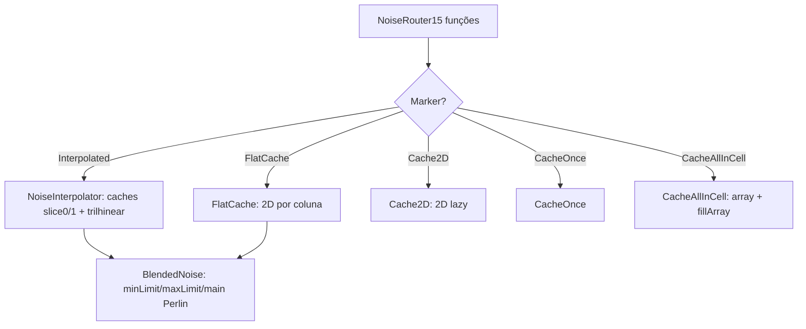

# Mundo — Sistema de ruído (Noise system, 26.1.2)

**Confiança:** [FATO] · Evidência: `research/discoveries/E5-world-generation.md`

## Visão geral
3 tipos de ruído + marcadores de otimização, tudo dentro de `DensityFunction`:

## BlendedNoise — a fórmula real do terreno [FATO]
- 3 PerlinNoise: `minLimit` octaves −15..0, `maxLimit` −15..0, `main` −7..0.
- `xzMultiplier = 684.412 * xzScale`, `yMultiplier = 684.412 * yScale`.
- `mainX = x*xzMultiplier/xzFactor`; `mainY = y*yMultiplier/yFactor`; `mainZ = z*xzMultiplier/xzFactor`; smear `yMultiplier*smearScaleMultiplier` (e `/yFactor` para main).
- 8 iterações na parte main e 16 na parte min/max, com `pow /= 2` em cada uma; `factor = (mainNoiseValue / 10.0 + 1.0) / 2.0` (valores `isMax/isMin` tratam os limites);
- blendMin/blendMax ponderados por `factor`; `maxValue = minLimitNoise.maxBrokenValue(yMultiplier)`.

(Obs.: a parte final de `compute()` — combinação blendMin/blendMax/main — não foi lida até o fim nesta sessão; a estrutura interna e os coeficientes foram verificados.)

## PerlinNoise / ImprovedNoise
`PerlinNoise.create(random, firstOctave, amplitudes)` — cascata de octaves com amplitudes (`DoubleList`), `PerlinNoise.wrap()` aplicada antes de cada amostra (módulo 16? — a wrapper evita acumulação de floats; não inspecionada linha a linha).
`NormalNoise.getValue(x,y,z)`: amostra `first.getValue(x,y,z) + second.getValue(x·1.0181268882175227, …)` × `valueFactor = 0.166666.../expectedDeviation(maxOctave−minOctave)`, `expectedDeviation(span) = 0.1×(1+1/(span+1))` — nos parâmetros (-3..6? depende do registro).

## NoiseChunk — cache/interpolador de célula [FATO — lida linha a linha]
- `cellWidth`, `cellHeight` (`NoiseSettings.getCellWidth = QuartPos.toBlock(sizeH)`; overworld = 4 e 8).
- `firstCellX/Z`; `noiseSizeXZ = QuartPos.fromBlock(cellCountXZ × cellWidth)`.
- `initializeForFirstCellX()` → `fillSlice(slice0, 0)`; `advanceCellX` → `swapSlices` + `fillSlice(next, x+1)`.
- `selectCellYZ(y,z)`: `fillingCell=true` → preenche `CacheAllInCell` arrays (`fillArray`) → corners 8 em `NoiseInterpolator.slice*`.
- `updateForY/X/Z(pos, factor)`: `lerp(factor, noise000, noise010)` (Y), `lerp(factorX, valueXZ00, valueXZ10)` (X), `lerp(factorZ, valueZ0, valueZ1)` (Z) → `value` = densidade final.
- `getInterpolatedState()` requer `interpolating==true` — interpolator fora do loop lança `IllegalStateException("Trying to sample interpolator outside the interpolation loop")` (comportamento detectável, não silencioso).
- `getInterpolatedDensity()` = `fullNoiseDensity.compute(this)` — usada por `getInterpolatedNoiseValue` (debug) e por `DensityFunction.SinglePointContext` (debug screen).

## NoiseRouter — as 15 funções [FATO]
barrieiras (`barrier`), `fluid_level_floodedness`, `fluid_level_spread`, `lava`, `temperature`, `vegetation`, `continents`, `erosion`, `depth`, `ridges`, `preliminary_surface_level`, `final_density`, `vein_toggle`, `vein_ridged`, `vein_gap`.

`mapAll` + `NoiseWiringHelper` no RandomState instancia cada `NoiseHolder` com a `NormalNoise` real registrada em `Registries.NOISE` (ou legado Nether), e rewia `BlendedNoise` com `terrainRandom`.

## Cascata de registro (onde os valores são definidos)
- `DensityFunctions` — codecs Dispatch (`"minecraft:interpolated"`, `"minecraft:cache_2d"`, `"minecraft:shift_a"`, etc.) — diretório do mod/loader do datapack.
- `Noises` — registro `Registries.NOISE` dos NormalNoise vanilla (`minecraft:classic_terrain_noise` etc.).
- `NoiseRouterData` — cadeia final vanilla dos DensityFunction (`overworldRouter`, `netherRouter`, `endRouter`, etc.) — **não lida ainda** (W1).
- Datapack `data/<ns>/worldgen/noise_settings/*.json` — sobrescreve/pre define.

## Fórmulas-chave (declaradas pelo código)
- `xzMultiplier = 684.412 × xzScale`, `yMultiplier = 684.412 × yScale`.
- `valueFactor(NormalNoise) = 1/6 / expectedDeviation(span)`; `expectedDeviation = 0.1 × (1 + 1/(span+1))`.
- `factor(blend) = (noise/10 + 1) / 2`.
- `QuartPos.toBlock(n) = n << 4`, `QuartPos.fromBlock(x) = x >> 4`.

## Cadeia vanilla completa (NoiseRouterData, 26.1.2) [FATO]
`shiftX/shiftZ = flatCache(cache2d(shiftA/B(shiftNoise)))`;
`CONTINENTS/EROSION/RIDGES = flatCache(cache2d?/shiftedNoise2d(shiftX, shiftZ, 0.25, noises.X))`;
`RIDGES_FOLDED = mul(add(add(abs(w), (−0.6666666666666666)).abs(), (−0.3333333333333333)), −3.0)` (= peaksAndValleys);
`OFFSET = flatCache(cache2d(lerp(blendAlpha, blendOffset=0/10, spline(TerrainProvider.overworldOffset(continents, erosion, ridgesFolded, amplified)))))`;
`FACTOR`, `JAGGEDNESS` idem (blend targets 10.0 / zero);
`DEPTH = yClampedGradient(−64, 320, 1.5, −1.5) + OFFSET`;
`initialDensity = mul(constant(4.0), mul(depth + jaggedness, factor).quarterNegative())`;
`SLOPED_CHEESE = add(initialDensity, BASE_3D_NOISE_OVERWORLD(BlendedNoise 0.25/0.125/80/160/8))`;
`caves = rangeChoice(slopedCheese, −∞..1.5625, min(slopedCheese, 5×ENTRANCES), underground(SPAGHETTI_2D, SPAGHETTI_ROUGHNESS, LAYER, CHEESE, PILLARS))`;
`fullNoise = min(postProcess(slideOverworld(caves)), NOODLE)`, `postProcess = mul(interpolated(blendDensity(x)), 0.64).squeeze()`.
Nether: `slideNetherLike(BASE_3D_NOISE_NETHER)` sobre zero; End: `islands = cache2d(endIslands(0L))` + `SLOPED_CHEESE_END = add(endIslands, BASE_3D_NOISE_END)`.

## Limitações
- Cadeia vanilla exata (`final_density` squeezed etc.) não lida — não inventar os coeficientes de "continents→depth→ridges" aqui; qualquer documento futuro que cite a forma exata DEVE marcar fonte = data pack JSON (não este arquivo).
- `PerlinNoise.wrap` operação não dissecada.
