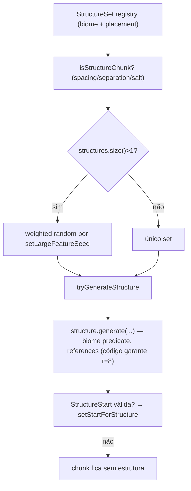

# Mundo — Estruturas, cavernas e decoração (26.1.2)

**Confiança:** [FATO] · Evidência: `research/discoveries/E5-world-generation.md`

## 0. Ordenação de features (FeatureSorter) [FATO]
`FeatureSorter.buildFeaturesPerStep(featureSources, featureGetter, tryReducingError)` → grafo `FeatureData[step, index]` com arestas para o PRÓXIMO feature na lista do mesmo bioma → DFS topológico (`Graph.depthFirstSearch`) → ciclos detectados (com `tryReducingError` reduz fontes iterativamente; senão `IllegalStateException("Feature order cycle found")` com `reducedSources`). `indexMapping()` global por `Util.createIndexIdentityLookup`; `StepFeatureData` por step. Consumidor: `ChunkGenerator.featuresPerStep` (cache memoizado por generator) → `applyBiomeDecoration`.

## 1. Estruturas — pipeline

- **`StructureSet`** record: `List<StructureSelectionEntry>` + `StructurePlacement` (`spacing`, `separation`, `salt`) — algoritmo grid-lattice (“grid” random dispersal) para grande estrutura (randomLargeFeature) OU nodos especiais (`RandomSpreadStructurePlacement`).
- **`createStructures`** (`ChunkGenerator`): chamado no estágio STRUCTURE_STARTS (`generateStructureStarts`), **fixado no chunk alvo**, olha apenas `possibleStructureSets()` do `ChunkGeneratorStructureState`; checagem `getStartForStructure` idem (skip se já existe start válido).
- **`createReferences`** (STRUCTURE_REFERENCES, r=8): itera estrutura de starts para registrar referências em chunks vizinhos — necessário para estruturas que cruzam chunks (filtragem de únicos starts/references pelo r=8).
- **`StructureManager`**: `startsForStructure(sectionPos, structure)`, `forWorldGenRegion(region)` — cria visão filtrada para WorldGenRegion; `setStartForStructure` / `addReferenceForStructure`.
- Biome predicate: `structure.biomes()` (HolderSet<Biome>) — passa para `structure.generate(..., biomePredicate, ...)`.
- Estrutura no `FEATURES` step: estruturas também se `structureManager.startsForStructure(...)` com `step() == stepIndex` — e **repete** a verificação de viabilidade de bioma durante a decoração (via `placeInChunk`).

## 2. Cavernas / Carvers
- `applyCarvers` (estágio CARVERS, r=8): para CADA chunk num raio de ±8 (17×17=289 chunks), lê os carvers do bioma daquele chunk (`biomeSource.getNoiseBiome` no quart X/Z mid) → `BiomeGenerationSettings.getCarvers()` → `random.setLargeFeatureSeed(seed + index, x, z)` → `isStartChunk` → `carve(...)`.
- Resultado: cavernas/cânions por biome via `CarverConfiguration` (probability, height, replaceable blocks etc. — não dissecado param a param).
- Blender: máscara (`Blender.addAroundOldChunksCarvingMaskFilter`) aplicada a antes carvers — evitacarve sobre chunks blendados antigos.
- `CarvingMask` serializado em NBT do chunk — descriptografado por 26.1.2 (`SerializableChunkData` leitura — ver `chunk-storage.md`).

## 3. Features / decoração
- `applyBiomeDecoration` (FEATURES):
  - `structuresByStep` — estruturas ordenadas por `GenerationStep.Decoration` (estruturas têm `step`).
  - `featureList = this.featuresPerStep.get()` (cache por generator) — `FeatureSorter.StepFeatureData` com `indexMapping()` (global indices) e `features()`.
  - Para cada stepIndex: coleta features dos biomas presentes em ~3×3 chunks (`possibleBiomes`, paletted containers), une as features por biome da etapa, deduplica por `IntArraySet` de índices globais, ordena, e coloca na ordem obtida com `setFeatureSeed(decorationSeed, globalIndex, stepIndex)` → `placeWithBiomeCheck(...)`.
  - `decorationSeed = setDecorationSeed(worldSeed, originX, originZ)`.
- FEATURES é o único estágio com `blockStateWriteRadius=1` — features podem escrever blocos em chunks vizinhos (e.g., árvore de fronteira); o gerador de features usa `WorldGenRegion` (`getChunk` garantida pela pirâmide).

## 4. Veios minerais / minérios
- Via `OreVeinifier.create(veinToggle, veinRidged, veinGap, oreRandom)` dentro do `blockStateRule` do ruído — determinístico, não features; alternativas: features `ore_*` do datapack.
- `Aquifer` — repositorytype: `Aquifer.create/Aquifer.createDisabled` — barrilhas de fluídos sob a superfície (sem fluxo, apenas bacia local) — parte do `blockStateRule` (`NoiseChunk` primata).

## 5. Spawn inicial
- `spawnOriginalMobs` no estágio SPAWN: `NaturalSpawner.spawnMobsForChunkGeneration(worldGenRegion, biome, center, random)` — usa bioma do centro; mobs “passíveis de worldgen” (e.g., animais de spawn pacivo) — **executa apenas em geração**, nunca em chunk load.
- Spawn point de mundo: `Climate.SpawnFinder` (em `Climate.java`) + `WorldOptions` — posição inicial via spawnTarget (climate target points) — calculada no bootstrap do servidor (`selectSpawnPoint`? — fora de escopo E5).

## 6. Diferenciação terreno vs. decoracão
| Aspecto | Terreno (NOISE/SURFACE) | Decoração (FEATURES) |
|---|---|---|
| Frequência | todos os blocos | por feature |
| Determinismo | seed → noise | seed → feature seeds |
| Vizinhos | r=1 (NOISE/SURFACE) | r=1 (CARVERS)/r=1 write (FEATURES) |
| Estado alvo | BlockState via rule | placed features placeWithBiomeCheck |
| DecorationsStep | — | `GenerationStep.Decoration.*` |
| Interação com light | nenhuma | nenhuma direta |

## 7. Limites
- FeatureSorter é global (feito por generator, não por chunk) — não dissecado.
- Estrutura placement exato (isStructureChunk — spacing/separation Grid/RandomSpread) não dissecado em detalhes de fórmula; apenas mecanismo verificado.
- Nível `/seed` externas — não verificado contra a wiki [DOC].
