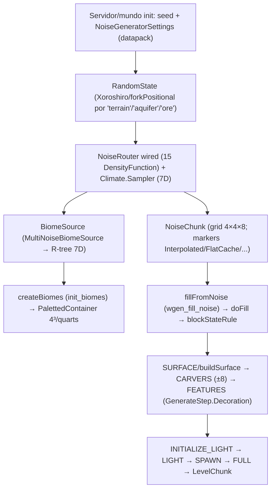

# Mundo — Geração procedural do mundo (26.1.2)

**Confiança:** [FATO] · Evidência completa: `research/discoveries/E5-world-generation.md`
Documentos irmãos: `noise-system.md` · `biome-generation.md` · `chunk-generation-stages.md` · `structures-and-features.md`

## Visão geral

## Como o chunk nasce — fluxo real (resumo)
1. `ChunkMap` agenda EMPTY (carga) ou GENERATION_PYRAMID; `NoiseBasedChunkGenerator.fillFromNoise` roda em `wgen_fill_noise` executor (bg, cores−1).
2. Cada `doFill` itera células X→Z→Y; `NoiseInterpolator` garante valores trilhineares suaves (células de 4×8 blocos no overworld).
3. `blockStateRule` (Aquifer → OreVeins) decide BlockState por bloco; fluidos via `Aquifer.computeSubstance`.
4. Heightmaps `OCEAN_FLOOR_WG`/`WORLD_SURFACE_WG` atualizados durante o fill; `MOTION_BLOCKING*`/WORLD_SURFACE no FEATURES (primeHeightmaps).
5. Features/estruturas rodam no estágio FEATURES (write radius=1); hydrationCarvers ANTES (write radius=0).
6. Light → SPAWN → FULL (main thread executor) → chunk pronto.

## Seeds e determinismo
- `RandomState.create(settings, noises, seed)` — tudo deriva de `seed` via `PositionalRandomFactory.fromHashOf`/`forkPositional` (nomes de string: "terrain", "aquifer", "ore", hologram hashes).
- Estruturas: `setLargeFeatureSeed(seed, x, z)` + biome predicate → determinístico por chunk.
- Decoração/features: `setDecorationSeed(seed, originX, originZ)` + `setFeatureSeed(decoSeed, index, step)`.
- Legacy/CU/End: `EndIslandDensityFunction(seed)` para ilhas do End.

## Configuração do mundo (NoiseGeneratorSettings) [FATO — classe]
`NoiseGeneratorSettings` record (`settings`: `NoiseSettings` minY/height/sizeH/sizeV, `useLegacyRandomSource`, `seaLevel`, `defaultFluid`, `defaultBlock`, `disableMobGeneration`, `aquifersEnabled`, `oreVeinsEnabled`, `noiseRouter()` — NoiseRouter acima — `spawnTarget`, `surfaceRule()`, `defaultBlocks` etc. — via codec).
Overworld: `OVERWORLD_NOISE_SETTINGS = (-64, 384, 1, 2)`.

## Relações com outros sistemas
- **Cargas/tickets**: governados por E4 (tickets) — geração em si só acontece com ticket; E5 não muda nada.
- **Iluminação**: INITIALIZE_LIGHT/LIGHT após FEATURES (ver `lighting-engine.md`).
- **Armazenamento**: `.mca` + `Status` (ver `chunk-storage.md`) — 26.1.2 NÃO grava nada de noise no disco (tudo deriva da seed + datapack) — exceto blending_data/ abaixo-zero-retrogen (dados de conversão legado).
- **Estruturas**: StructureSet + Placement (spacing/separation/salt) — `createStructures`/`createReferences` (ver `structures-and-features.md`).

## Resoluções E5b (W1–W8, 2026-11-05)
Ver `../research/discoveries/E5-world-generation.md` §11 (cadeia overworld completa) e `worldgen-internals.md` (Aquifer/OreVeinifier/WorldGenRegion/FeatureSorter/EndIsland/TerrainProvider). Correção à nota acima: `depth = yClampedGradient(-64, 320, 1.5, -1.5) + OFFSET` (offset = spline 2D continent/erosion/ridges) — verificado no código do `NoiseRouterData.registerTerrainNoises` (`offsetToDepth`).

## Armadilhas
- Bioma de um bloco ≠ bioma "para 4×4×4" — quart blocks: 4×4×4 blocos por quart; o PALETTED container guarda a mesma referência para todo o quart.
- `depth` ≠ altura em bloco — `Depth` é função composta (`1.0 - 2.0 * y/(height)` ou similar no router; NÃO verificada numericamente).
- Código de geração pode retornar estado vazio (`BlockState null`) — cae no `defaultBlock()`; céu = nenhum bloco (AIR é state null de purpose?) — `state == null → defaultBlock` no fill, AIR é literal `Blocks.AIR` (contado no `state != AIR` check).
