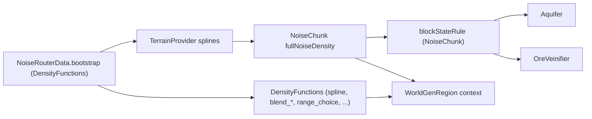

# Mundo — Worldgen: Aquifer, OreVeinifier, EndIslands, TerrainProvider, WorldGenRegion, FeatureSorter (26.1.2)

**Confiança:** [FATO] · Evidência: `research/discoveries/E5-world-generation.md` §11 (W1–W8)

## 1. Aquifer (NoiseBasedAquifer)
- **Grade**: X/Z espaçamento 16, Y espaçamento 12 (`X_SEPARATION=6`? — na verdade `X_SPACING=16, Y_SPACING=12, Z_SPACING=16`), semente por célula com `positionalRandomFactory.at(gridX, gridY, gridZ)` → offset aleatório ±10/9/10 por eixo (`SAMPLE_OFFSET_X=-5, SAMPLE_OFFSET_Y=1, SAMPLE_OFFSET_Z=-5`).
- **Seleção**: 2×3×2 = 12 candidatos; guarda 4 mais próximos (`distanceSqr`). Cache: `aquiferLocationCache` (Long.MAX_VALUE = livre), `aquiferCache` (FluidStatus por index).
- **similarity(d1²,d2²) = 1 − (d2²−d1²)/25**; `FLOWING_UPDATE_SIMULARITY = similarity(100, 144)`.
- **Pressure**: `calculatePressure(context, barrierNoiseValue, status1, status2)` → `barrierNoise.compute(...)`; "density + barrier > 0" ⇒ bloco sólido.
- **Decisão de fluido**: `density > 0` → null (sólido); `posY > skipSamplingAboveY` → globalFluid; lava global → lava direto; `computeFluid(center)`:
  - `topOfAquiferCell = y+12`, `bottomOfAquiferCell = y−12`;
  - `SURFACE_SAMPLING_OFFSETS_IN_CHUNKS` = 3 amostras (0,0) e (±2,±2?) seções; `adjustSurfaceLevel(=+8)`;
  - se centro está abaixo do nível global de fluido em superfície → retorna global;
  - se top poke acima → `globalFluidAtSurface` (e marca `surfaceAtCenterIsUnderGlobalFluidLevel`);
  - `computeSurfaceLevel`: `OverworldBiomeBuilder.isDeepDarkRegion(erosion, depth, ctx)` ⇒ floodedness = −1 (sem aquifers no deep dark); senão `floodednessNoise` clamp ±1 → `fullyFloodedness = noise − map(factor,1,0,-0.3,0.8)`, `partiallyFloodedness = noise − map(factor,1,0,-0.8,0.4)`;
  - `fullyFloodidness > 0` → `globalFluid.fluidLevel`; `partiallyFloodedness > 0` → `computeRandomizedFluidSurfaceLevel` (células 16×40, `fluidLevelSpread*10 → quantize 3`, min com `lowestPreliminarySurface`); senão `WAY_BELOW_MIN_Y`;
  - `computeFluidType`: se `fluidSurfaceLevel ≤ −10` e não lava global → `lavaNoise` (células 64×40) `|noise| > 0.3` ⇒ LAVA.
- **shouldScheduleFluidUpdate**: true quando os 2–4 aquiferos próximos diferem (e 4º ainda sem confirmação) ⇒ chunk marca postprocesso (fluído precisa fluir na fase FULL → `postProcessGeneration`).

## 2. OreVeinifier
- Fonte de toggle: `vein_toggle` (`yLimitedInterpolatable` noise 1.5 scale, Y −60..50 COPPER / −60..−8 IRON pela mesma função com sinal); `vein_ridged` (abs de `ore_vein_a/b`); `vein_gap`.
- Condições (na ordem): `|toggle| + edgeRoundoff ≥ 0.4`, `positionalRandom.nextFloat() ≤ 0.7`, `veinRidged < 0`, `nextFloat() < richness && gap > −0.3`.
- `COPPER`: Y 0..50, `COPPER_ORE`/`RAW_COPPER_BLOCK` 2%, filler GRANITE. `IRON`: Y −60..−8, `DEEPSLATE_IRON_ORE`/`RAW_IRON_BLOCK` 2%, filler TUFF.
- `richness = clampedMap(|toggle|, 0.4, 0.6, 0.1, 0.3)`; `edgeRoundoff = clampedMap(distFromEdge, 0, 20, −0.2, 0)`.
- Roda como segundo `BlockStateFiller` (após Aquifer) no `blockStateRule` do NoiseChunk.

## 3. TerrainProvider (splines de terreno)
- `TerrainProvider.overworldOffset(continents, erosion, ridgesFn, amplified)` — spline: `-1.1 → 0.044`, `-1.02..-0.51 → −0.2222` (deep ocean), beach/high splines (`buildErosionOffsetSpline(erosion, ridges, ...)`); `overworldFactor`/`overworldJaggedness` idem; `overworldOffset` alimenta `OFFSET`, `DEPTH`, `SLOPED_CHEESE`.
- `AMPLIFIED_OFFSET/FACTOR/JAGGEDNESS` closures aplicadas só em `overworld_amplified/*`.

## 4. OverworldBiomeBuilder
- Conjunto de thresholds (`temperatures[5]`, `humidities[5]`, `erosions[7]`, `continentalness` segments) + `depth`/`weirdness` e `isDeepDarkRegion(erosion, depth, context)` (thresholds −0.225/0.9) usado por Aquifer e spawn.
- `spawnTarget()` — lista de 3 ParameterPoints (savana-like/plains-like? — não lida por inteiro; valores específicos não citaDOS).
- Referência cruzada: `Aquifer.computeSurfaceLevel` (deep dark ⇒ sem floodedness) + preset system do datapack.

## 5. EndIslandDensityFunction
- Simplex noise (`SimplexNoise(LegacyRandomSource(seed)` com `consumeCount(17292)`); `getHeightValue(sectionX = x/8, sectionZ = z/8)`:
  `doffs = clamp(100 − sqrt(x²+z²)·8, −100, 80)`;
  loop xo,zo ∈ [−12..12]: se `|chunk|² > 4096L && noise < −0.9` → `islandSize = (|x|*3439 + |z|*147) % 13 + 9`; `doffs = max(doffs, clamp(100 − sqrt((x−2xo-?)² + ...)·islandSize, −100, 80))` — na prática: vizinhos produzem ilhas menores a distância; `compute` → `(doffs−8)/128`.
- Consumo: `NoiseRouterData.end()` usa `cache2d(endIslands(0L))` como ridge (continents) e `SLOPED_CHEESE_END = add(endIslands, BASE_3D_NOISE_END)`.

## 6. WorldGenRegion
- `WorldGenRegion` implementa `WorldGenLevel`; `getChunk(x,z)` só devolve chunks com distância Chebyshev `< directDependencies().size()`; fora → `ReportedException("Requested chunk unavailable during world generation")` com categoria completa.
- `hasChunk` idem; `getBlockState/getBiome` via `getChunk`; `WorldGenTickAccess` delega `blockTicks/fluidTicks` de cada chunk.
- `random` = `randomState.getOrCreateRandomFactory("worldgen_region_random").at(center Pos)`; `BiomeManager` com seed obfuscado (`BiomeManager.obfuscateSeed`).

## 7. FeatureSorter
- `buildFeaturesPerStep`: constrói grafo FeatureData[step, idx] com arestas para o PRÓXIMO na lista do mesmo bioma; DFS topológico; detecta ciclo → tenta reduzir fontes iterativamente (se `tryReducingError`) → senão `IllegalStateException("Feature order cycle found")` com `reducedSources`.
- `indexMapping()` global (identity lookup) usada por `applyBiomeDecoration` para índices de step.

## 8. Diagrama — cadeia de dependências (verificado)

