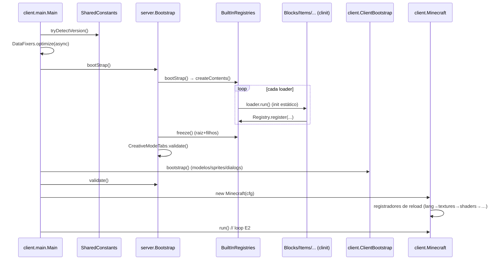

# E1 — Caminho de inicialização do Minecraft (26.1.2)

- **Data:** 2026-11-04/05 · **Versão:** 26.1.2 (unobfuscada) · **Confiança:** alta [FATO]
- **Fontes:** `tools/MinecraftSourcesGenerator/sources/26.1.2/` (decompile local Vineflower, VANILLA)
- **Experimento:** E1 (ver `experiments/README.md`)

## Fluxo completo do cliente [FATO]

```
net.minecraft.client.main.Main.main(String[])
  1. jopt-simple OptionParser — --accessToken e --version obrigatórios; --gameDir, --width/--height, --demo, --quickPlay*…
  2. JvmProfiler (se --jfrProfile) / TracyBootstrap (se --tracy)
  3. SharedConstants.tryDetectVersion()                      // metadados da versão
  4. DataFixers.optimize(TYPES_FOR_LEVEL_LIST)               // CompletableFuture assíncrono
  5. CrashReport.preload()
  6. stage = "Bootstrap"
  7. net.minecraft.server.Bootstrap.bootStrap()              // registries + conteúdos
  8. net.minecraft.client.ClientBootstrap.bootstrap()        // SOMENTE lado cliente (modelos/sprites/dialogs)
  9. GameLoadTimesEvent.setBootstrapTime(Bootstrap.bootstrapDuration)
 10. Bootstrap.validate()                                    // DefaultAttributes.validate(); traduções só se IDE
 11. GameConfig (User, DisplayData, FolderData, GameData, QuickPlayData)
 12. Util.startTimerHackThread(); dataFixerOptimization.join()
 13. shutdown hook ("Client Shutdown Thread" → IntegratedServer.halt(true))
 14. Thread.currentThread().setName("Render thread"); RenderSystem.initRenderThread()
 15. new Minecraft(gameConfig)                               // janela, backends, recursos
 16. minecraft.run()                                         // loop principal (E2)
```

Erros de inicialização viram `CrashReport` com categoria "Initialization" e `Minecraft.crash(...)`.

## `Bootstrap.bootStrap()` (server/Bootstrap.java) — ordem exata [FATO]

1. `BuiltInRegistries.REGISTRY.keySet().isEmpty()` → lança IllegalStateException ("Unable to load registries")
2. `FireBlock.bootStrap()` — registra comportamento de fogo a partir do mapa de ignição
3. `ComposterBlock.bootStrap()` — níveis de compostagem
4. `EntityType.getKey(EntityType.PLAYER)` sanity check
5. `EntitySelectorOptions.bootStrap()`, `DispenseItemBehavior.bootStrap()`, `CauldronInteractions.bootStrap()`
6. `BuiltInRegistries.bootStrap()` → `createContents()` + `freeze()` + `validate(REGISTRY)`
7. `CreativeModeTabs.validate()`
8. stdout/stderr → `LoggedPrintStream` (ou `DebugLoggedPrintStream` se debug)
9. `bootstrapDuration.set(...)` (nanos→ms)

Idempotente: guarda `isBootstrapped` volatile.

## Como os registries se populam de fato [FATO — BuiltInRegistries.java linha ~180, ~397]

```java
// declaração estática (exemplo):
public static final DefaultedRegistry<Block> BLOCK =
    registerDefaultedWithIntrusiveHolders(Registries.BLOCK, "air", registry -> Blocks.AIR);

// internalRegister:
Bootstrap.checkBootstrapCalled(...)             // guard: só roda dentro do bootstrap
LOADERS.put(key, () -> loader.run(registry));   // loader LAZY
WRITABLE_REGISTRY.register(name, registry, RegistrationInfo.BUILT_IN);
```

`createContents()` executa cada loader **uma única vez**; o primeiro acesso dispara `<clinit>` da classe de conteúdo (ex.: `Blocks`), cujos `register(...)` estáticos chamam `Registry.register(BuiltInRegistries.BLOCK, ResourceKey, Block)`. Depois: `REGISTRY.freeze()` + freeze de todos os registries filhos + `bindBootstrappedTagsToEmpty(registry)`. A partir daí, registries são **imutáveis** e lookups por default (`air`) não falham.

Ordem de carga real de conteúdos: definida pela ordem dos campos em `BuiltInRegistries` (BLOCK, ITEM, …) × ordem estática dos loaders — `Blocks` antes de `Items` (Items referencia Blocks). Conteúdo dos registries: classes `.../Blocks.java`, `Items.java` etc. com `public static final` fields arkeados por `register(...)`.

## `ClientBootstrap.bootstrap()` (client/ClientBootstrap.java) [FATO]
Apenas lado-cliente e estritamente renderização/GUI:
`ItemModels`, `SpecialModelRenderers`, `ItemTintSources`, `SelectItemModelProperties`, `ConditionalItemModelProperties`, `RangeSelectItemModelProperties`, `SpriteSources`, `DialogScreens`, `InputControlHandlers`, `DialogBodyHandlers`.
Nada aqui toca registries — ClientBootstrap depende de Bootstrap já ter congelado os registries? (Não confirmado que depende; apenas que roda depois.)

## Servidor dedicado [FATO parcial]
`net.minecraft.server.Main#main` (net/minecraft/server/Main.java):
1. `SharedConstants.tryDetectVersion()`
2. jopt-simple parser: `--nogui`, `--initSettings` (gera server.properties + eula.txt e sai), demais flags…
3. (restante do fluxo análogo: Bootstrap.bootStrap() → construção de `DedicatedServer` — confirmar linhas exatas em sessão futura)
Entrypoint: `net.minecraft.server.Main`. `DedicatedServer` em `net/minecraft/server/dedicated/DedicatedServer.java`.

## Reload de recursos no cliente (pós-construção) [FATO — Minecraft.java ~511]
O construtor de `Minecraft` registra reload listeners em `ReloadableResourceManager(CLIENT_RESOURCES)` na ordem:
LanguageManager → TextureManager → ShaderManager → SkinManager → (LevelStorageSource, não-listener) → MusicManager → SoundManager → SplashManager → AtlasManager → FontManager → GrassColor → FoliageColor → DryFoliageColor.
Isso define a ordem de aplicação de resource packs (fontes → texturas/atlas → shaders …). `SoundManager` e `TextureManager` tick via `textureManager.tick()` no runTick.

## Diagrama Mermaid


## Confirmações × incertezas
- [FATO] Ordem bootstrap → ClientBootstrap; loaders lazy; freeze; reload listeners.
- [DOC] Fabric Wiki diz entrypoints `net.minecraft.client.main.Main` / `net.minecraft.server.Main` — confirmado no código.
- [NÃO DESCOBERTO] Ordem exata de construção da janela/GLFW dentro de `Minecraft.<init>` (linhas ~400-500 do construtor) — Blaze3D init está antes dos listeners; detalhar se necessário.
- [NÃO DESCOBERTO] Servidor: ponto exato de `Bootstrap.bootStrap()` em `server/Main.java` (visto início do main; o corpo completo não foi lido nesta sessão).
- [HIPÓTESE] `ClientBootstrap` pode ser chamado após registries congelados sem depender deles — não verificado.

## Arquivos-chave
- sources/26.1.2/net/minecraft/client/main/Main.java (main completo)
- sources/26.1.2/net/minecraft/server/Bootstrap.java
- sources/26.1.2/net/minecraft/client/ClientBootstrap.java
- sources/26.1.2/net/minecraft/core/registries/BuiltInRegistries.java
- sources/26.1.2/net/minecraft/SharedConstants.java
- sources/26.1.2/net/minecraft/server/Main.java (início)
