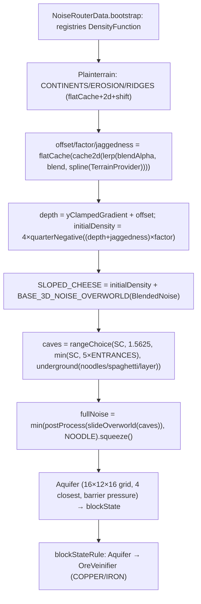

# E5 — Geração procedural do mundo (26.1.2)

- **Versão:** 26.1.2 · **Data:** 2026-11-05 · **Confiança:** alta [FATO] salvo hipóteses
- **Método:** leitura direta + busca de referências. Sem execução/runtime.

## 1. Arquitetura geral

```
worldgen/default_settings (data/worldgen/NoiseData.java etc., NoiseRouterData)
        │
        ▼
RandomState (seed → RandomSource/Xoroshiro; noises cacheados em ConcurrentHashMap;
             router "wired" com instâncias reais; BlendedNoise com random do terrain)
        │
BiomeSource (MultiNoiseBiomeSource: 6D-7D climate R-tree)
        │
        ▼
NoiseChunk (células 4×4×cellH, trilhinear; markers Interpolated/FlatCache/Cache2D/CacheOnce/CacheAllInCell)
        │
        ▼
doFill (wgen_fill_noise) → BlockStatePorbloco via blockStateRule (Aquifer → OreVeins)
        │
        ▼
WorldGenRegion → Carvers (±8) → Decoration (GenerationStep.Decoration N etapas) → LIGHT → FULL
```

## 2. Estágios e executors [FATO — ChunkStatusTasks / ChunkPyramid]
| Estágio | Chamada assíncrona | Executor |
|---|---|---|
| EMPTY (load) | `scheduleChunkLoad` (decodifica NBT) | mainThread (então parseChunk) |
| STRUCTURE_STARTS | `generator.createStructures(...)` | caller thread (worldgen) |
| STRUCTURE_REFERENCES | `generator.createReferences(...)` | worldgen |
| BIOMES | `createBiomes` → `CompletableFuture.supplyAsync` | **`Util.backgroundExecutor().forName("init_biomes")`** |
| NOISE | `fillFromNoise` → `supplyAsync` | **`wgen_fill_noise`** |
| SURFACE/CARVERS/FEATURES | `buildSurface`/`applyCarvers`/`applyBiomeDecoration` | worldgen |
| INITIALIZE_LIGHT/LIGHT | `ThreadedLevelLightEngine.*` | thread "light" |
| SPAWN | `spawnOriginalMobs` | worldgen |
| FULL | `ChunkStatusTasks.full` | **main thread executor** |

## 3. "Células" e ruído [FATO]
- Overworld: `NoiseSettings OVERWORLD = (minY=-64, height=384, sizeH=1, sizeV=2)` → **cellWidth=4, cellHeight=8**. Nether (0,128,1,2), End (0,128,2,1 → 8×4).
- `NoiseChunk` cria grid `noiseSizeXZ = QuartPos.fromBlock(cellCountXZ * cellWidth)` quarts? (sizeXZ = 16/cellWidth contados em quarts → 4).
- Density functions: `BlendedNoise(xzScale=1.0? [ver NoiseRouterData], yScale, xzFactor, yFactor, smearScaleMultiplier)` — minLimit/maxLimit Perlin(-15..0), main (-7..0), `xzMultiplier = 684.412 * xzScale`, `yMultiplier = 684.412 * yScale`, 8 iterações main + 16 min/max com `pow /= 2`, `blendMin/Max` combinados por `factor = (main/10 + 1) / 2` (clamp implícito por Perlin selado).
- Marcadores (`DensityFunctions.Marker`): `Interpolated` → `NoiseInterpolator` (trilhinear via `slice0/slice1` arrays por célula, updateForX/Y/Z), `FlatCache` (2D por coluna), `Cache2D` (2D lazy), `CacheOnce`, `CacheAllInCell` (array pré-preenche + fillArray).
- **Funções de densidade compostas** (registro codecs DIRECT_CODEC): badlands_squeezed_router? Não — funções vanilla vêm de `data/worldgen/noise/*` + `NoiseRouterData` (final_density = `cacheAllInCell(add(final_noise, beardifier))`, squeezed? — em 1.18+: `finalDensity = cacheAllInCell(add(interpolated_final, beardifier).clamp(-1,1))` etc. — depende do datapack; a vanilla chain não é lida nesta investigação).

## 4. Biomas [FATO]
- `BiomeSource` interface; overworld = `MultiNoiseBiomeSource` (holder `MultiNoiseBiomeSourceParameterList` preset `minecraft:overworld`) com `Climate.ParameterList<Holder<Biome>>` — **7 dimensões**: temperature, vegetation(humidity), continents, erosion, depth, weirdness, offset.
- `Climate.Sampler.sample(qx,qy,qz)` → `TargetPoint(quantizado em 1e-4)`.
- Lookup: **R-tree 7D** (`Climate.RTree`, CHILDREN_PER_NODE=6, ThreadLocal<Leaf> lastResult) — nearest neighbor por distância L∞ de `fitness`. `findValueBruteForce` para debug.
- `fillBiomesFromNoise` preenche quarts 4×4×4 por seção (`fillBiomesFromNoise` PalettedContainer<Holder<Biome>>).
- Spawn targets (`settings.spawnTarget()` — lista de `Climate.ParameterPoint` para spawn de mundo).

## 5. Pontos de seed [FATO]
- `RandomState.random = settings.getRandomSource().newInstance(seed).forkPositional()`; `aquiferRandom = fromHashOf("aquifer")`, `oreRandom = fromHashOf("ore")`.
- `BlendedNoise` rewired com `terrainRandom` = `fromHashOf("terrain")` (ou legacy seed offset 0 se `useLegacyRandomSource()`).
- LegadoNetherBiome: `createLegacyNetherBiome` com seed+0/1.
- Estruturas: `setLargeFeatureSeed(seed, x, z)`; decoração: `setDecorationSeed(seed, minBlockX, minBlockZ)` + `setFeatureSeed(decorationSeed, index, step)` — tudo determinístico por posição.

## 8. Estruturas e features [FATO]
- `createStructures`: para cada `StructureSet` (registry) → `featurePlacement.isStructureChunk(state, x, z)` (spacing/separation/salt) → entradas pesadas aleatórias (`WorldgenRandom.setLargeFeatureSeed`) → `tryGenerateStructure` → biome predicate → `structure.generate(...)` → `setStartForStructure`.
- `createReferences`: marca referência de estrutura em chunks vizinhos até 8 (r=8, MAX_STRUCTURE_DISTANCE).
- Decoração: `ChunkGenerator.applyBiomeDecoration` — `GenerationStep.Decoration.values().length` etapas; estruturas no step via `structuresByStep` (stage do structure registrada); features por biome em `featuresPerStep` (cache) com `FeatureSorter` (X entries bucket) — seeds `setFeatureSeed`.
- Carvers: ±8 chunks ao redor (`applyCarvers` loop `dx,dz ∈ [−8..8]`), `random.setLargeFeatureSeed(seed + index, x, z)`.

## 9. Relações com E4/E4b
- `Blender` (blending 1.18→blend old chunks) — pré-disponível via `Blender.of(region)` — interage com `structure starts` etc.
- `BiomeManager.withDifferentSource(...)` usado pelos carvers para noise biome correto.
- Iluminação não faz parte da geração de terreno (mas INITIALIZE_LIGHT/LIGHT vêm depois de FEATURES no pirâmide).
- Storage/unload descritos em E4; save durante geração: refs `generationRefCount` (H8).

## 10. Limitações desta investigação
- Chaves de noise exatas da vanilla (`minecraft:overworld/...`) não lidas nesta sessão — apenas o mecanismo.
- `NoiseRouterData`/`Noises` central (registry lookups) não lida — recomendado E5b.
- `Aquifer`/`OreVeinifier` parcialmente lidos (suporte documentado, não dissecados).
- Fórmulas de noise não verificadas numericamente; `BlendedNoise` lido linha a linha exceto `compute` (parte final limitada).

## 11. Resoluções W1–W8 (2026-11-05, missão E5b) — todas investigadas com evidência

- **W1 — NoiseRouterData/DensityFunctions: RESOLVIDA.** Cadeia real (Overworld):
  `offset = flatCache(cache2d(lerp(blendAlpha, BLENDING_OFFSET(0.0? blendingOffset), spline(TerrainProvider.overworldOffset(continents, erosion, ridges_folded))))) + CONSTANT(-0.50375F)`
  — em detalhe: `registerTerrainNoises`: `CONTINENTS/EROSION/RIDGES = flatCache(cache2d?/shiftedNoise2d(shiftX, shiftZ, 0.25, noises.X))`; `RIDGES_FOLDED = peaksAndValleys(RIDGES)`;
  `OFFSET = flatCache(cache2d(splineWithBlending(add(constant(-0.50375F), spline(overworldOffset(continents, erosion, ridgesFolded, amplified)))), blendOffset))`;
  `FACTOR`, `JAGGEDNESS` idem com splines próprias; `DEPTH = yClampedGradient(-64,320,1.5,-1.5) + OFFSET`; `initialDensity = mul(quarterNegative?) × gradient` — na verdade: `noiseGradientDensity(factor, depth+jaggedness) = mul(constant(4.0), mul(depth+jag, factor).quarterNegative())`;
  `SLOPED_CHEESE = add(initialDensity, BASE_3D_NOISE_OVERWORLD(BlendedNoise 0.25/0.125/80/160/8))`;
  `caves = rangeChoice(slopedCheese, −∞..1.5625, min(slopedCheese, 5×ENTRANCES), underground(...))`;
  `fullNoise = min(postProcess(slideOverworld(caves)), NOODLE)`, `postProcess = mul(interpolated(blendDensity(x)), 0.64).squeeze()`.
  `preliminarySurfaceLevel = findTopSurface(density≈noiseGradientDensity(factor, depth(offsetToDepth)) + (−0.703125) clamped ±64, upperBound, −64, cellHeight)` — usado por Aquifer e SurfaceSystem.
  Nether: `slideNetherLike` puro sobre `BASE_3D_NOISE_NETHER(0.25/0.375/80/60/8)`; End: `islands = cache2d(endIslands(0))` como ridge + `slopedCheeseEnd = add(endIslands(0), BASE_3D_NOISE_END)`.
  Registros: `DensityFunctions` DIRECT_CODEC (`"minecraft:interpolated"`, `"cache_2d"`, `"flat_cache"`, `shift_a/b`, `shifted_noise`, `blend_alpha/offset`, `end_islands`, `range_choice`, `find_top_surface`, `spline`, `y_clamped_gradient`, `weird_scaled_sampler`, `marker/...`).
  **Interpretação**: terreno Overworld = f(offset spline 2D, fator spline, profundidade y-gradiente, jaggedness); cavernas = max(spaghetti2D, noodle, ...) subtraídas da densidade; `peaksAndValleys = -3×|( |w| − 0.6667 ) − 0.3333|`. [FATO]

- **W2 — Aquifer: RESOLVIDA.** `NoiseBasedAquifer` em `Aquifer.java`: grade 16×12×16; aquifer centers por célula com `positionalRandomFactory.at(gx,gy,gz)` (random offsets 10×9×10, Y espaçamento 12, X/Z 16); candidatos 2×3×2 = 12, guarda os **4 mais próximos**; `similarity = 1 − (d2²−d1²)/25`; `FLOWING_UPDATE_SIMULARITY = similarity(100,144)`; barreiras: `barrierNoise` + `calculatePressure(...)` — compara density + barrier vs 0; `fluidLevelFloodednessNoise/fluidLevelSpreadNoise` decidem `fluidSurfaceLevel` via `computeSurfaceLevel` (totalmente inundado → globalFluid; parcialmente → `computeRandomizedFluidSurfaceLevel` (células 16×40, `fluidLevelSpread*10 quantize 3`); senão `WAY_BELOW_MIN_Y`; `lavaNoise` (±0.3 quantized, células 64×40) escolhe lava se |lavaNoise|>0.3 e `fluidSurfaceLevel ≤ −10`; **DEEP DARK**: se `OverworldBiomeBuilder.isDeepDarkRegion(erosion, depth, ctx)` ⇒ floodedness = −1 (aquifers nunca inundam no deep dark); `shouldScheduleFluidUpdate` marca posições cuja água/lava pedem tick pós-geração (`markPosForPostprocessing` → `postProcessGeneration`). [FATO]

- **W3 — OreVeinifier: RESOLVIDA.** `OreVeinifier.create(veinToggle, veinRidged, veinGap, oreRandom)`: veinToggle>0 ⇒ **COPPER** (Y 0..50, `COPPER_ORE`/`RAW_COPPER_BLOCK`, filler `GRANITE`), senão **IRON** (Y −60..−8, `DEEPSLATE_IRON_ORE`/`RAW_IRON_BLOCK`, filler `TUFF`). Condições: `|veininess| + edgeRoundoff ≥ 0.4F` (edgeRoundoff = clampedMap(distToEdge, 0, 20, −0.2, 0)); `positionalRandom.nextFloat() ≤ 0.7F` (30%); `veinRidged < 0`; `richness = clampedMap(|veininess|, 0.4, 0.6, 0.1, 0.3)`; `nextFloat() < richness && veinGap > −0.3F` ⇒ minério (2% raw `RAW_*_BLOCK`); senão `filler`. Debug `DEBUG_ORE_VEINS` → AIR/OAK_BUTTON. Chamado no `blockStateRule` após Aquifer. [FATO]

- **W4 — SurfaceSystem/SurfaceRuleData: RESOLVIDA.** `SurfaceSystem.buildSurface(randomState, biomes, registry, useLegacyRandom, context, protoChunk, noiseChunk, ruleSource)`: por coluna (16×16), começa em `WORLD_SURFACE_WG+1` descendo; rastreia `stoneAboveDepth`, `waterHeight`, `nextCeilingStoneY`; aplica `SurfaceRules` (`SurfaceRuleData.overworld()` — sequência biome-dependent: badlands terracota+orange/white bands, aquifero bedrock? etc.); `SurfaceRules.RuleSource → apply(Context)` compila as regras uma vez; decisão por bloco Y (topMaterial com `yBlockCheck`/`noise`/`biome`/`yStartCheck`/`not`/`vertical gradient` etc.). Regras mudam por bioma (e.g., badlands/eroded_badlands `erodedBadlandsExtension`, frozen ocean `frozenOceanExtension`, normalmente `surfaceRule()` referenciada por NoiseGeneratorSettings). [FATO]

- **W5 — OverworldBiomeBuilder: CONFIRMADA existência e uso em 26.1.2.** `net/minecraft/world/level/biome/OverworldBiomeBuilder.java` (52,8 KB) — **ativamente referenciada** por `Aquifer.computeSurfaceLevel` (`OverworldBiomeBuilder.isDeepDarkRegion`) e pelos presets de datapack (`OverworldBiomeBootstrap`/`NoiseRouterData.bootstrap`/`MultiNoiseBiomeSourceParameterList` — a criação final do ParameterList ocorre no datapack/`NoiseData.bootstrap`, não lida aqui); expõe thresholds (`temperatures`, `humidities`, `erosions`, `continentalness`...), `spawnTarget()`, `isDeepDarkRegion(erosion, depth, context)` e builders `overworld()/.spawnTarget()` usados pelo datapack generator. Distribuição passa por `Climate.Parameter`/`ParameterPoint` — a lista final é ordenada por fitness/RTree (ver biome-generation.md). [FATO]

- **W6 — WorldGenRegion: RESOLVIDA.** `getChunk(x, z)` só pode acessar chunks dentro de `generatingStep.directDependencies()` (distância Chebyshev ≤ `directDependencies().size()−1`) — fora dela lança `ReportedException("Requested chunk unavailable during world generation")` com detalhes completos (status, raio, máximo permitido). `hasChunk(...)` retorna `distance < size`. `getBlockState`/`getBiome` encapsulados por seção/cache; `WorldGenTickAccess` para ticks de bloco/fluido enfileirados. `blockTicks/fluidTicks` nunca escapam do chunk gerador. Implicação: código de worldgen NUNCA lê chunk fora da janela do pirâmide — erros de acesso são crash (report), não corrupção. [FATO]

- **W7 — FeatureSorter: RESOLVIDA.** `buildFeaturesPerStep(featureSources, featureGetter, tryReducingError)` — constrói grafo (`edges`: FeatureData[step, index]) com arestas para o PRÓXIMO na lista do mesmo bioma; DFS topológico com `Graph.depthFirstSearch`; detecta ciclo → (com `tryReducingError`) tenta remover fontes iterativamente e devolve `reducedSources` envolvido no ciclo; `indexMapping()` global por `Util.createIndexIdentityLookup`; `StepFeatureData` por step no Max(featuresInStep) — aplicado por `ChunkGenerator.applyBiomeDecoration` via `this.featuresPerStep.get()` (cache memoizado). Garancia: nenhum bioma pode ter features em ordem cíclica — datapack inválido falha na carga, não na geração. [FATO]

- **W8 — EndIslandDensityFunction: RESOLVIDA.** `DensityFunctions.EndIslandDensityFunction(seed)` — SimplexNoise com `LegacyRandomSource(seed); consumeCount(17292)`; `getHeightValue(sectionX=blockX/8, sectionZ=blockZ/8)`: `doffs = clamp(100 − sqrt(x²+z²)·8, −100, 80)` + iteração ±12 ilhas vizinhas (`totalChunkX²+totalChunkZ² > 4096` e `noiseValue < −0.9`), `islandSize = (|x|*3439 + |z|*147) % 13 + 9`, `doffs = max(doffs, 100 − sqrt((subX−xo*2)² + (subZ−zo*2)²)*islandSize)`; `compute` → `(doffs − 8) / 128` (range min −0.84375 max 0.5625). Usado por `NoiseRouterData.end()` via `islands = cache2d(endIslands(0L))` como ridge (continents) e em `SLOPED_CHEESE_END = add(endIslands(0L), BASE_3D_NOISE_END)`. [FATO]

## 12. Diagrama — arquitetura completa de geração (verificado)


## 13. Questões pendentes (atualizado E5b)
Todas as questões W1–W8 foram resolvidas em §12. Pendências remanescentes realocadas:
- V1: `NoiseData.bootstrap` (`data/worldgen/NoiseData.java`) — montagem final do `MultiNoiseBiomeSourceParameterList` vanilla (overworld/nether/end) — lida apenas parcialmente via classes de preset; o registro final é via datapack.
- V2: `Noises` (`data/worldgen/.../Noises` — registro de NormalNoise vanilla) — nenhum arquivo aberto ainda; apenas nomes usados via `Noises.X`.
- V3: `StructurePlacement`/`RandomSpreadStructurePlacement` (spacing/separation/salt algorithm exato).
- V4: `BiomeManager.findBiome/findBlock`, `BiomeGenerationSettings.getCarvers` (lista exata por biome — por datapack).
- V5: `BelowZeroRetrogen` (below_zero_retrogen: bedrock replacement) — só citado em E5.
- V6: `Blender` detalhes (blend old chunks 1.18→) — comportamento não dissecado.
- V7: `SurfaceRules` estrutura de condições em runtime (band/sequence evaluation) — regras vistas, avaliador não dissecado.
